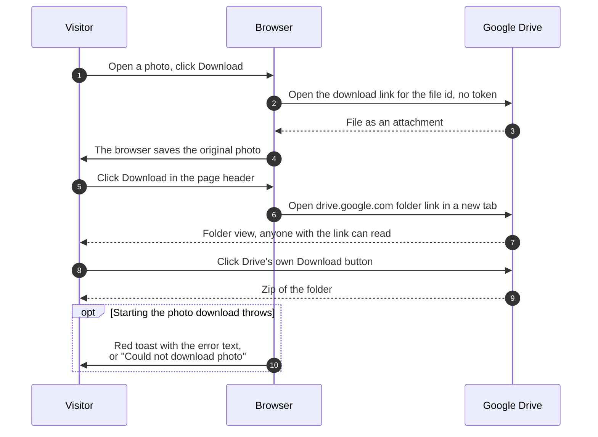

# Download photos

> **Question:** How can a visitor download one photo or a whole album?
>
> **Answer:** Anyone who can open an album can download. In the photo viewer, the download button saves the full-size original straight from Google. The Download button in the page header, shown when the album has photos, opens the album's folder in Google Drive in a new tab, where Drive's own Download button makes a zip of everything. The Worker is not involved and no sign-in or token is used, because every album folder is readable by anyone with the link.
>
> **Notes:**
> - Google offers no way to make a zip of a folder for anonymous visitors, so the folder link is the only whole-album download.
> - The expiry banner "Will be deleted on DATE" tells visitors to download what they want, because there is no backup.
> - The single photo link is `drive.usercontent.google.com/download?id=FILE_ID&export=download&confirm=t`. The page shows a red toast only if starting the download throws, using the error's own text or "Could not download photo". A failed transfer is shown by the browser or Google, and the page does not see it.
> - Thumbnails and the viewer use Google's image servers, not Drive's download: 600 px, 1920 px, 800 px for covers.

