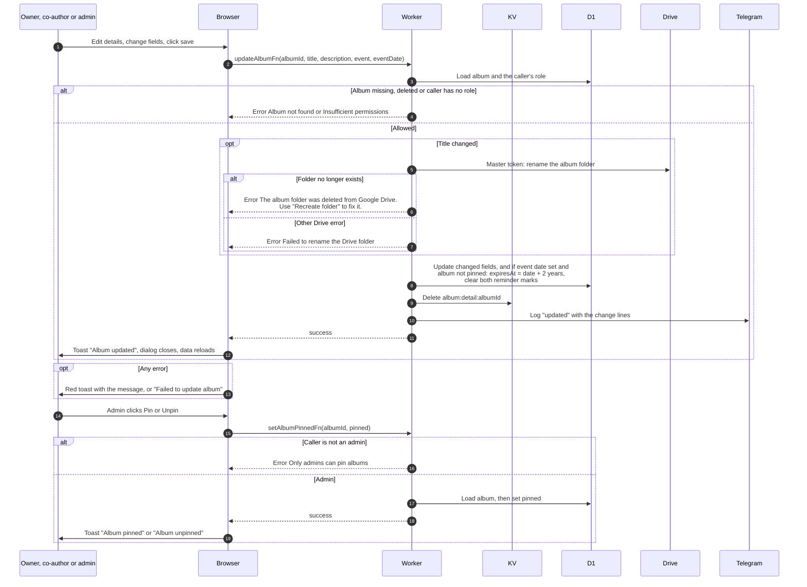

# Edit album details and pin an album

> **Question:** What happens when someone edits an album's details, or an admin pins it?
>
> **Answer:** The owner, co-authors and admins or managers can change title, event, event date and description. A new title also renames the Drive folder using the master token. A new event date moves the expiry to 2 years after it and resets the 30 day and 7 day reminders, unless the album is pinned. The page shows "Album updated". Only admins (not managers) can pin an album, which stops the expiry job from deleting it, and the page shows "Album pinned" or "Album unpinned".
>
> **Notes:**
> - The edit form always sends every field, so the Telegram log for an edit always lists the description and event lines, even when nothing changed.
> - The Drive rename happens before the database save. If the rename fails, nothing is saved.
> - Unpinning does not change the stored expiry date. An album whose date has passed while pinned will be picked up by the expiry job at its next run after unpinning. See cron/albums-and-housekeeping/.
> - Pinning hides the "Will be deleted" banner. The role check for pin is the admin role only, not the manager role.

