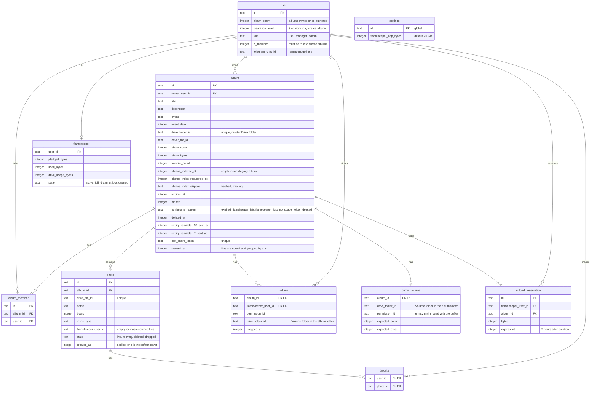

# Album data

> **Question:** Which tables, KV keys and Drive folders do the album scenarios read and write?
>
> **Answer:** Albums are stored in the album table with their co-authors in album_member and their photos in photo. Favorites point at photos, and the settings row holds the per-flamekeeper storage cap. Photos held by the buffer carry the owner value `buffer`, and each album has one buffer_volume row with the expected photo count and bytes. Photos stored by flamekeepers before the buffer carry the flamekeeper's user id, with one volume row per flamekeeper. Upload reservations now only serve the browser relay. Short-lived copies of album pages and lists sit in KV. No R2 storage is used for albums.
>
> **Notes:**
> - KV `album:detail:ALBUM_ID`: shared album page core (photos, authors, cover, folder health), TTL 3600 s, plus a 30 s per-Worker memory copy.
> - KV `album:list:FOLDER_ID`: Drive folder listing and health (ok, trashed, missing), TTL 300 s.
> - KV `album:publist:HASH`: one page of the public gallery, TTL 600 s, plus a 30 s per-Worker memory copy.
> - KV `photo-backfill:budget`: day and writes spent by the indexer, TTL 2 days.
> - Drive layout in the master account: Albums / year / month / album title, with a "Volume xxxxxx" folder inside for the buffer, and for each flamekeeper who held photos before it. New photo files are owned by the buffer. See create-album.md and upload-to-buffer.md.
> - Photo state values other than live (moving, deleted, dropped) belong to the flamekeeper moves, see flamekeepers/.
> - The ids: album id 10 characters, edit token 24 characters, reservation id 16 characters, co-author link id 12 characters, photo id 16 characters.
> - Column names are the database names, for example album_count and clearance_level.
> - R2 is not used for albums. Cover and photo images come from Google's image servers.

