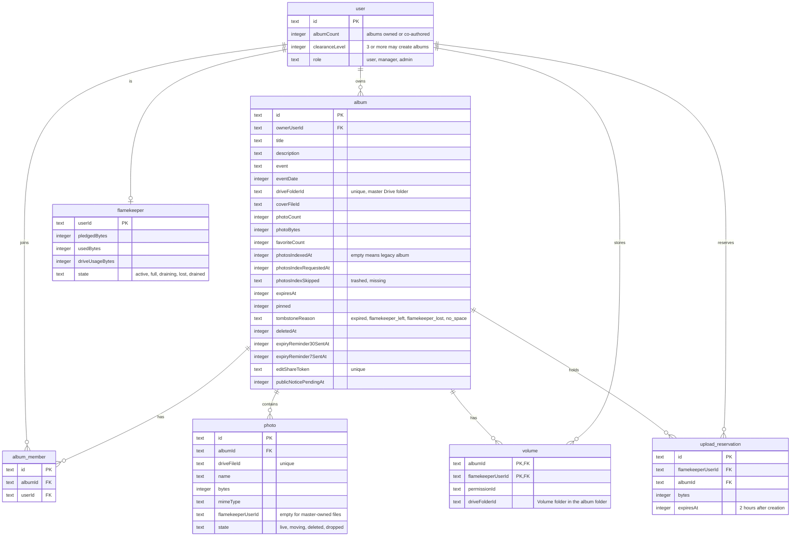

# Album data

> **Question:** Which tables, KV keys and Drive folders do the album scenarios read and write?
>
> **Answer:** Albums are stored in the album table with their co-authors in album_member and their photos in photo. Photos stored by flamekeepers carry the flamekeeper's user id, and each album has one volume row per flamekeeper who stored photos in it. Upload reservations hold space for uploads in progress. Short-lived copies of album pages and lists sit in KV. No R2 storage is used for albums.
>
> **Notes:**
> - KV `album:detail:ALBUM_ID`: shared album page core (photos, authors, cover, folder health), TTL 3600 s, plus a 30 s per-Worker memory copy.
> - KV `album:list:FOLDER_ID`: Drive folder listing and health (ok, trashed, missing), TTL 300 s.
> - KV `album:publist:HASH`: one page of the public gallery, TTL 600 s, plus a 30 s per-Worker memory copy.
> - KV `photo-backfill:budget`: day and writes spent by the indexer, TTL 2 days.
> - Drive layout in the master account: Albums / year / month / album title, with a "Volume xxxxxx" folder inside for each flamekeeper. Photo files are owned by the flamekeeper who uploaded them. See create-album.md and upload-pick-flamekeeper.md.
> - Photo state values other than live (moving, deleted, dropped) belong to the flamekeeper moves, see flamekeepers/.
> - The ids: album id 10 characters, edit token 24 characters, reservation id 16 characters.

