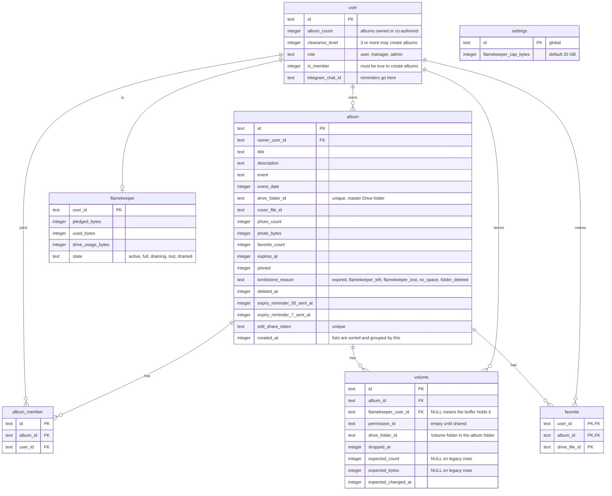

# Album data

> **Question:** Which tables, KV keys and Drive folders do the album scenarios read and write?
>
> **Answer:** Albums are stored in the album table with their co-authors in album_member and their photos in Drive, read through cached listings (there is no photo table, see [ADR-0017](../../adr/0017-drop-photo-table-read-from-drive.md)). The album row keeps a photo count and byte total that uploads, deletes and listing refreshes maintain. Favorites are keyed by album and Drive file id, and the settings row holds the per-flamekeeper storage cap. Each album has one buffer volume row (a volume row with no flamekeeper) with the expected photo count and bytes, and photos that flamekeepers hold from before the buffer sit in one volume row per flamekeeper, with those two left empty. Copies of album pages and Drive listings sit in KV. No R2 storage is used for albums.
>
> **Notes:**
> - KV `album:detail:ALBUM_ID`: shared album page core (title, event, authors), TTL 6 hours, plus a 30 s per-Worker memory copy.
> - KV `album:list:FOLDER_ID`: Drive listing of each volume and folder health (ok, trashed, missing), TTL 8 days, see [ADR-0017](../../adr/0017-drop-photo-table-read-from-drive.md).
> - Edge Cache API entry per query hash: one page of the public gallery, TTL 600 s, plus a 30 s per-Worker memory copy. Not KV.
> - Drive layout in the master account: Albums / year / month / album title, with a "Volume xxxxxx" folder inside for the buffer, and for each flamekeeper who held photos before it. New photo files are owned by the buffer. See create-album.md and upload-to-buffer.md.
> - The ids: album id 10 characters, edit token 24 characters, co-author link id 12 characters.
> - Column names are the database names, for example album_count and clearance_level.
> - R2 is not used for albums. Cover and photo images come from Google's image servers.

