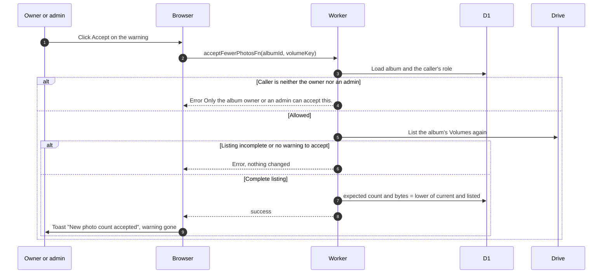

# Warning for fewer photos than expected

> **Question:** What do owners and admins see when a buffer Volume lists fewer photos than it should, and what does Accept do?
>
> **Answer:** The manage panel shows "Fewer photos than expected" with how many photos were found out of how many are expected, and an Accept button. Admins also see an "Open volume in Google Drive" link and which account holds the Volume (today always the buffer). Accept lowers the Volume's expected count and bytes to what a fresh listing shows, and the warning goes away. Only the album owner and admins can see or accept it.
>
> **Notes:**
> - The warning is raised when the Volume's listed count or listed bytes is lower than its expected count or bytes. The expected values are kept by uploads and photo deletes, see upload-send-and-confirm.md and delete-photo.md. The rule is the planCountWarning planner in `src/lib/albums/count-warning.ts`.
> - Only buffer Volumes can raise it. Older flamekeeper and master Volumes have no expected values, so they never do (see GLOSSARY.md, Volume).
> - It is never raised from a doubtful listing. The Volume that warns must have a complete listing no older than its freshness window, and the album folder must be ok. A partial, failed, missing, unavailable or last-good listing of that Volume shows no warning. Other sections of the album (for example an unreadable legacy volume) do not silence it.
> - Files added by hand in Drive never raise it, they can only make the listing larger. The buffer listing sees only files the app created, see ADR-0017.
> - Uploads cannot raise it. The expected values go up only after an upload is confirmed, so a file still being confirmed is listed but not yet expected.
> - Accept never trusts the browser. The Worker checks that the caller is the owner or an admin, lists the album again from Drive, runs the same checks, and only then lowers the values. A failed or incomplete listing refuses with "nothing was changed". Files created in the last 10 minutes are left out of the new values because their confirm may still land and would add them again. The values can only go down.
> - Non-admins never receive the volume link or holder: the Worker leaves them out of the album it returns. The warning is built per viewer after the shared cached core, so the cache holds nothing of it.
> - No health check reads buffer Volumes in Stage 1. checkFlamekeeperHealth only probes flamekeeper tokens, so the warning comes from album listings only.

