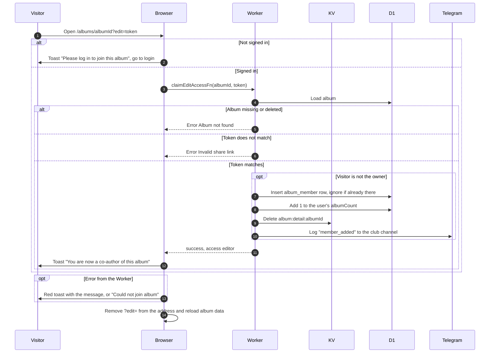

# Join an album with an edit link

> **Question:** What happens when someone opens an album's edit link?
>
> **Answer:** The link is the album address with ?edit= and the album's edit token. A signed in user who opens it becomes a co-author, with rights to upload, edit details, refresh and delete photos, and sees the toast "You are now a co-author of this album". A guest gets "Please log in to join this album" and is sent to the login page. A wrong or old token gives "Invalid share link". The owner opening their own link changes nothing. In every case the browser then removes ?edit= from the address.
>
> **Notes:**
> - Co-authors cannot delete the album, rotate the link, or remove other people, but they can leave the album, see manage-authors.md.
> - Opening the link twice does not create a second membership, but the user's album count goes up by 1 each time the link is used by a non-owner.
> - Making a new link and cancelling old ones is in rotate-edit-link.md.
> - Co-authors can be added by anyone who has the link. There is no approval step.

