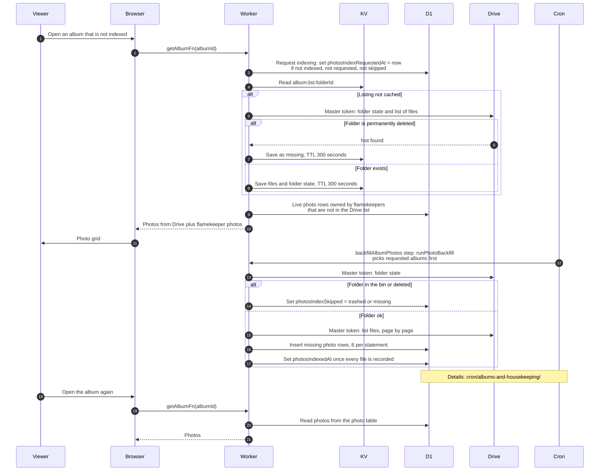

# Legacy albums that are not indexed yet

> **Question:** How is an older album shown when its photos are not yet recorded in the database, and how does it become a normal album?
>
> **Answer:** An album with no indexing date (photosIndexedAt empty) has its photos read straight from its Drive folder with the master token, plus any flamekeeper-owned photos already in the database, because the master cannot see those. Opening such an album also asks the background indexer to prioritise it. A 5-minute cron job later copies the folder's image list into the photo table and stamps the album as indexed. After that the album is read from the database like any new album. If the folder is in the Drive bin or deleted, indexing is skipped and marked until the folder is restored.
>
> **Notes:**
> - The indexer is in cron/albums-and-housekeeping/ and is not redrawn here. Each run handles at most 5 albums and 500 photos and respects a daily write budget (default 60000 writes, 3 per photo) kept in KV `photo-backfill:budget` with a 2 day TTL. Albums that someone opened go first (oldest request first), then the newest event date first.
> - The request is a single D1 write that only applies when the album is not indexed, not already requested and not skipped.
> - The Drive listing is cached in KV `album:list:FOLDER_ID` for 5 minutes. Refresh clears it, see refresh-album.md.
> - Restoring a folder clears the skipped mark so indexing can try again, see restore-folder.md.
> - Legacy albums behave differently elsewhere too: upload checks the Drive folder for a same-name file, deleting a photo that is not in the table deletes it with the master token, and setting a cover skips the ownership check. See upload-start.md, delete-photo.md and set-cover-photo.md.

