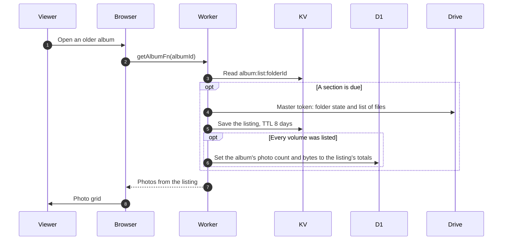

# Legacy albums

> **Question:** How is an album from before the buffer stored and shown, and does it behave differently from a new one?
>
> **Answer:** Not any more. It is shown like any other album, from the cached Drive listing, see view-album.md. Its photos sit in the album's root folder, which the listing reads with the master token, and any photos a flamekeeper holds from before the buffer are listed from that flamekeeper's volume. There is no photo table and no indexer, so nothing has to be recorded before the album works (the 5-minute indexer was removed in #25, see [ADR-0017](../../adr/0017-drop-photo-table-read-from-drive.md)). Deleting a file or setting a cover needs the file to be in the album's listing, exactly as for new albums.
>
> **Notes:**
> - The album row's photo count and bytes start at whatever was stored before and are replaced by the exact totals the first time a complete listing of the album is read.
> - A trashed or deleted folder only shows a warning, see deleted-folder-warning.md.
> - Upload checks duplicates against the listing, see upload-start.md. Deleting and covers are in delete-photo.md and set-cover-photo.md.

