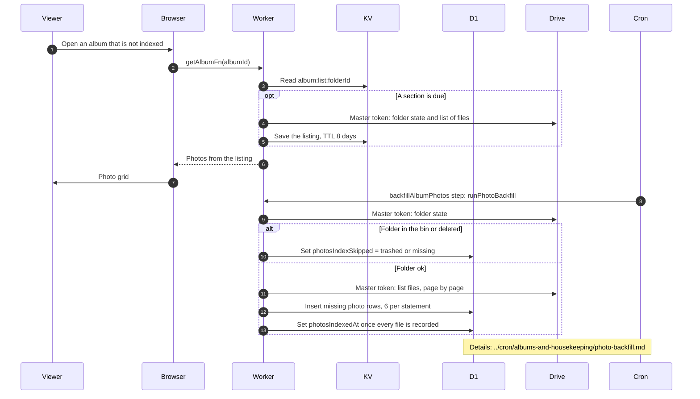

# Legacy albums that are not indexed yet

> **Question:** How is an older album shown when its photos are not yet recorded in the database, and how does it become a normal album?
>
> **Answer:** It is shown like any other album, from the cached Drive listing, see view-album.md. Its photos sit in the album's root folder, which the listing reads with the master token. Opening it no longer asks the indexer for anything. A 5-minute cron job still copies the folder's image list into the photo table and stamps the album as indexed, because expiry reads that table until it is removed. If the folder is in the Drive bin or deleted, indexing is skipped and marked until the folder is back and the album is refreshed.
>
> **Notes:**
> - The indexer is described in ../cron/albums-and-housekeeping/photo-backfill.md and is not redrawn here. Each run handles at most 5 albums and 500 photos and respects a daily write budget (default 60000 writes, 3 per photo) kept in KV `photo-backfill:budget` with a 2 day TTL.
> - A trashed or deleted folder only shows a warning, see deleted-folder-warning.md.
> - Legacy albums behave differently elsewhere: upload checks the Drive folder for a same-name file, deleting a file id with no row and no listing deletes it with the master token, and setting a cover skips the ownership check. See upload-start.md, delete-photo.md and set-cover-photo.md.

