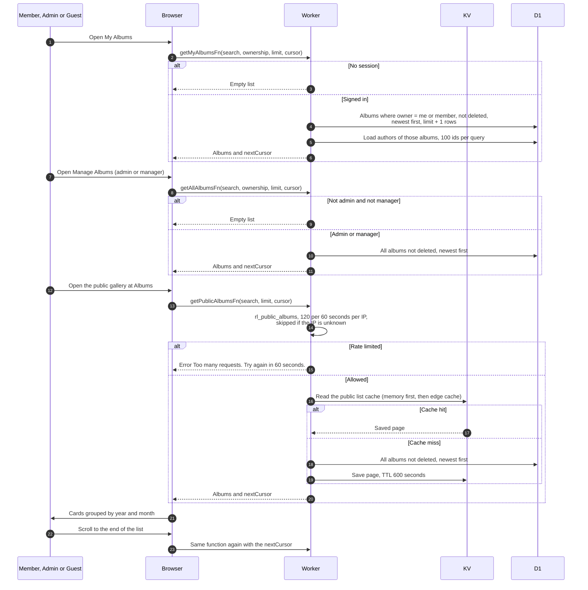

# Browse album lists

> **Question:** How do the three album lists (My Albums, Manage Albums, public Albums) load, who can see what, and how fresh are they?
>
> **Answer:** All three lists show albums that are not deleted, newest created first, 24 per page, grouped by the year and month the album was created, and load more as you scroll. My Albums shows albums you own or co-author, Manage Albums (admin or manager only) shows every album, and the public gallery at /albums shows every album to anyone, signed in or not. Search matches title or description. The public list is limited to 120 requests a minute per IP and is cached, so a new or changed album can take up to 10 minutes to show there.
>
> **Notes:**
> - Public list cache: a 30 second memory copy per Worker instance (25 entries) in front of the edge Cache API (no KV writes) under a key made from a hash of the query, with a 10 minute TTL, kept per data centre. Nothing clears it when albums change.
> - The lists are always refetched on a visit or window focus (staleTime 0). The public cache is the only delay.
> - Not signed in on My Albums, or not admin or manager on Manage Albums, returns an empty list instead of an error.
> - The ownership filter ("Owned by me" and "Shared with me") exists on My Albums and Manage Albums only. On Manage Albums "Shared with me" means every album owned by someone else.
> - The server accepts a page size of 1 to 100. The web pages always ask for the default of 24.
> - Grouping uses the creation date in UTC, not the event date.
> - Cover images come from Google's CDN, see download-photos.md for how images load.
> - Opening one album is in view-album.md.

