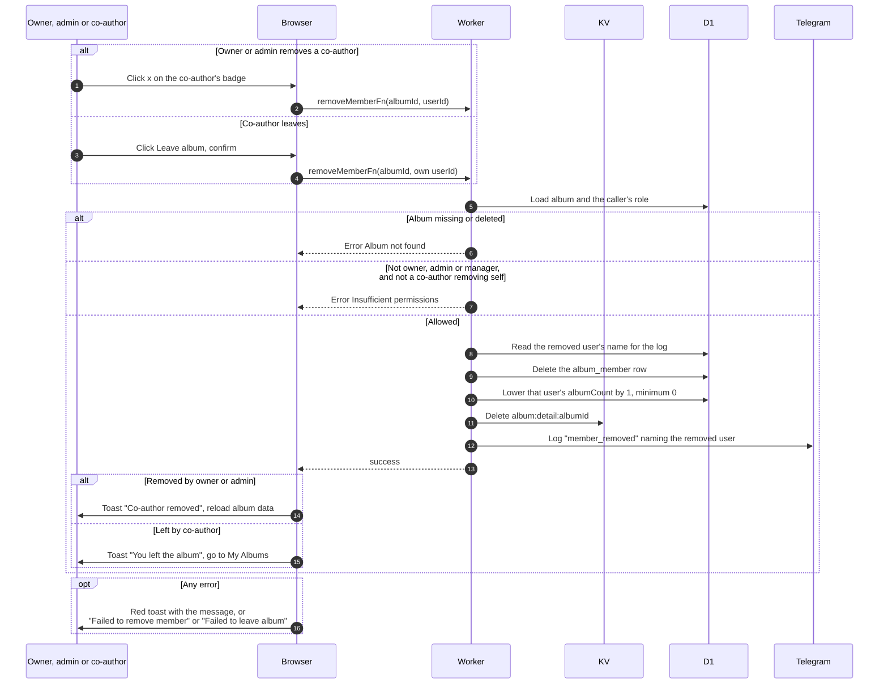

# Remove a co-author or leave an album

> **Question:** How does a co-author leave an album, and how does an owner remove someone?
>
> **Answer:** The owner and admins or managers can remove any co-author with the x on their name badge, and see the toast "Co-author removed". A co-author can only remove themselves with the Leave album button and confirmation, and sees "You left the album" before returning to My Albums. Anyone else gets "Insufficient permissions". The removed person loses upload and edit rights right away. The owner stays the same.
>
> **Notes:**
> - The page never offers a way to remove the owner or yourself with the x. The x does not appear on the owner's badge or on your own badge. The Worker itself does not refuse such a request, so a request for the owner's id would lower the owner's album count.
> - Removing lowers that user's album count by 1, never below 0, even if they were not actually a co-author.
> - Photos a co-author uploaded stay in the album.
> - The Leave album button appears only for co-authors. An admin or manager who joined with the edit link keeps the manager role and has no Leave button.

