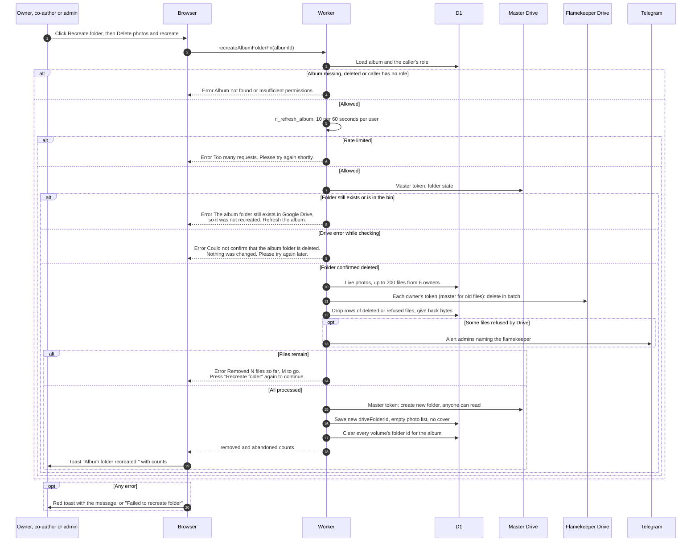

# Recreate a deleted album folder

> **Question:** What happens when an album's Drive folder was permanently deleted and someone clicks "Recreate folder"?
>
> **Answer:** The button appears on the red "Album folder deleted from Google Drive" notice for the owner, co-authors and admins or managers, and asks for confirmation. The Worker first proves the folder is really gone. Only then does it delete the album's photos from the flamekeepers' Drives, up to 200 files and 6 flamekeepers per press, and when none are left it creates a new empty folder, resets the album's photo list and cover, and the page shows a toast starting "Album folder recreated." followed by how many files were removed and how many could not be deleted. If any check fails, nothing is deleted and the person sees why. Large albums need several presses.
>
> **Notes:**
> - Checks that happen before any file is deleted: the caller's role, a limit of 10 requests a minute per person (shared with the Refresh button), and the folder check. The folder check must come back "deleted". "Exists in the bin or live" is refused, and a Drive error while checking is also refused, so doubt never causes a delete.
> - A file counts as gone when Google says it is deleted or already missing. Temporary Google answers are tried again on the next press. A flamekeeper whose access was revoked, or a Google refusal, makes those files "could not be deleted": their table rows are dropped so they do not block the album, the files stay in that flamekeeper's Drive, and admins get a Telegram message naming them.
> - The Telegram message to admins reads: #savenuimg: N files of NAME (EMAIL) in the recreated album "TITLE" could not be deleted and were left in their Drive. For files held by the master account it says "the club account" instead of a name.
> - The "keep pressing" error continues: "... Press "Recreate folder" again to continue. The new folder is created once all files are processed." When some files were refused it also says how many files couldn't be deleted.
> - The 200 files are counted across at most 6 owners per press, and the master account counts as one owner. Files of further owners wait for the next press.
> - Everything in the photo table for the album is cleared when the new folder is made, including rows in other states such as dropped photos. The refused files' rows are already gone by then.
> - After a successful recreate, every volume of the album forgets its folder, so the next upload to each flamekeeper creates a new Volume folder.
> - Restoring a folder that is only in the bin is a different, harmless action, see restore-folder.md.

