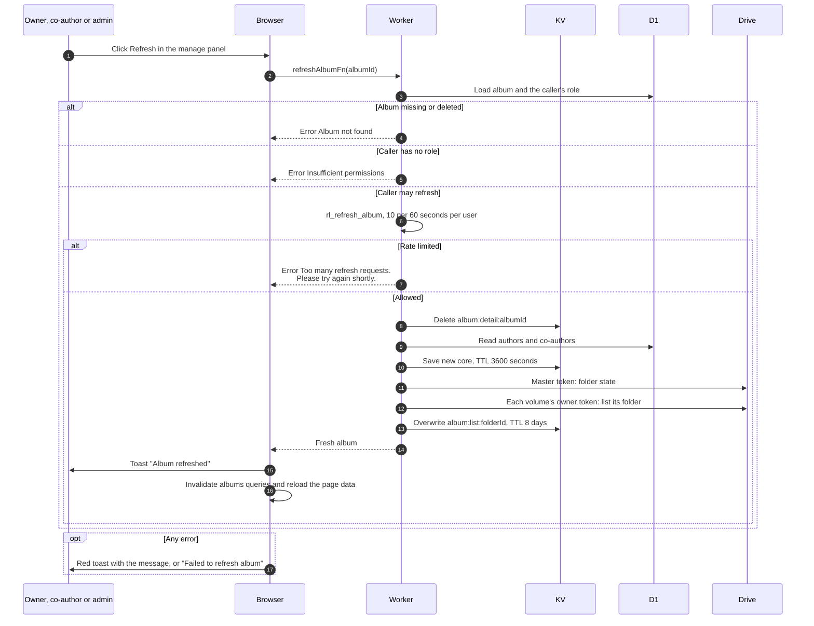

# Refresh an album

> **Question:** What does the Refresh button on an album page do?
>
> **Answer:** Refresh throws away the shared album core and lists every volume of the album in Drive again right away, so the person who pressed it and everyone after them see current data. It is available to the owner, co-authors and admins or managers, and each person can press it at most 10 times a minute. The page then shows the toast "Album refreshed".
>
> **Notes:**
> - Refresh re-checks the folder health in Drive (ok, in the bin, deleted), the authors and the file list of each volume. A volume that fails to list keeps its last listing, so Refresh never empties an album because Drive had a bad moment.
> - Refresh is not needed after an upload, see upload-send-and-confirm.md. It is the way to pick up changes made outside the app before the listing is due again.
> - Cache keys: KV `album:detail:ALBUM_ID` (1 hour) and `album:list:FOLDER_ID` (see [ADR-0017](../../adr/0017-drop-photo-table-read-from-drive.md)).
> - Who may use it is decided by albumContext, the same check used by most album actions: no session or no role gives "Insufficient permissions", and an unknown or deleted album gives "Album not found".

