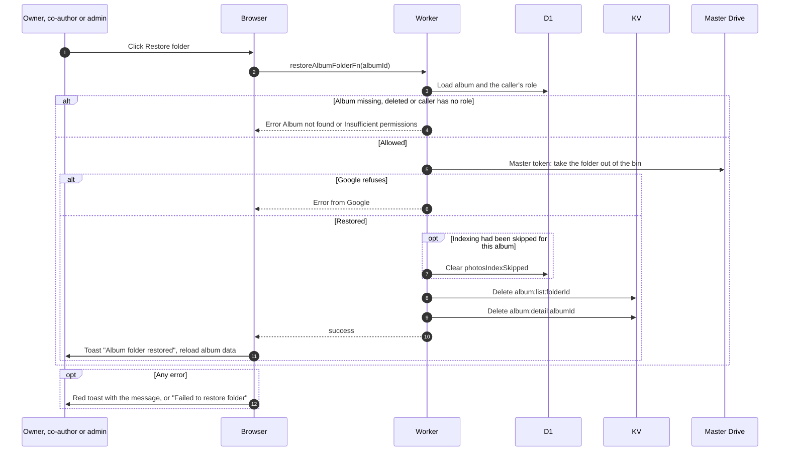

# Restore a folder from the Drive bin

> **Question:** What happens when an album's Drive folder is in the bin and someone clicks "Restore folder"?
>
> **Answer:** When the folder is in the Google Drive bin, the album shows "Album folder is in the Google Drive bin" and uploads are paused. The owner, co-authors and admins or managers click "Restore folder". The Worker takes the folder out of the bin with the master token, clears the "indexing skipped" mark if there was one, clears the cached copies, and the page shows "Album folder restored". Uploads work again. Nothing is deleted.
>
> **Notes:**
> - No confirmation dialog and no rate limit.
> - If Google cannot restore it (for example the folder was permanently deleted meanwhile), the error text is shown or "Failed to restore folder", and the page keeps showing the current state. For a permanently deleted folder use recreate-folder.md.
> - The bin state is noticed the next time the album core is rebuilt, which can take up to an hour unless Refresh is used, see refresh-album.md. The folder health itself is cached for 5 minutes.
> - The indexing mark that gets cleared belongs to legacy albums, see legacy-albums.md.

