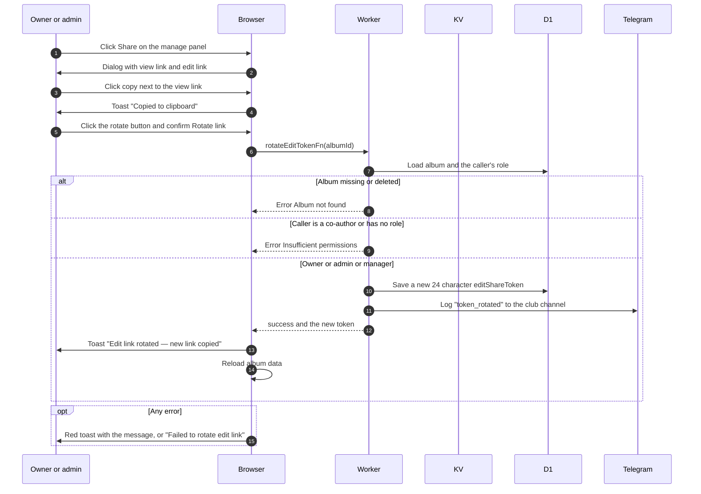

# Share and rotate the edit link

> **Question:** How do people copy an album's links, and what does rotating the edit link do?
>
> **Answer:** The Share dialog shows the view link, which anyone can open, and the edit link, which adds a signed in user as a co-author. Copying the view link puts a ready-made Telegram message (title, description, authors, link) on the clipboard. The owner and admins or managers can rotate the edit link: a new 24 character token replaces the old one, every earlier edit link stops working, and the new link is copied with the toast "Edit link rotated — new link copied". Existing co-authors keep their access.
>
> **Notes:**
> - Co-authors see the Share dialog and can copy both links but do not see the rotate button. Copying the edit link shows the toast "Link copied".
> - If the browser blocks the clipboard, the toast is "Edit link rotated" and the copy buttons show "Could not copy link" on failure.
> - Visitors without a role never receive the edit token from the server.

