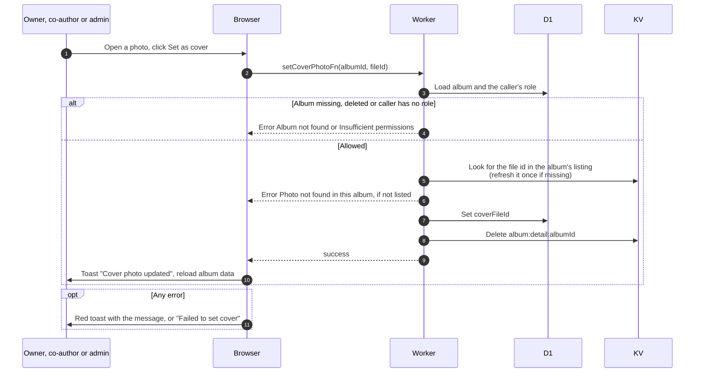

# Choose the album cover

> **Question:** How does someone pick a photo as the album's cover?
>
> **Answer:** The owner, co-authors and admins or managers open a photo and click "Set as cover", which is greyed out for the photo that is already the cover. The Worker checks that the photo is in this album's listing, refreshing a cached listing once if the file is missing from it, and saves it as the cover, and the page shows "Cover photo updated". If nobody picks one, the earliest uploaded photo is used and saved the first time the album page has a complete listing.
>
> **Notes:**
> - The check is the authorization: a file id that is not listed in this album's own folders is refused with "Photo not found in this album", so a cover can never point at a file from another album.
> - The cover appears on album cards from Google's image servers at 800 px, and as the link preview picture at 1200 px.
> - Deleting the cover photo clears the cover, see delete-photo.md.

