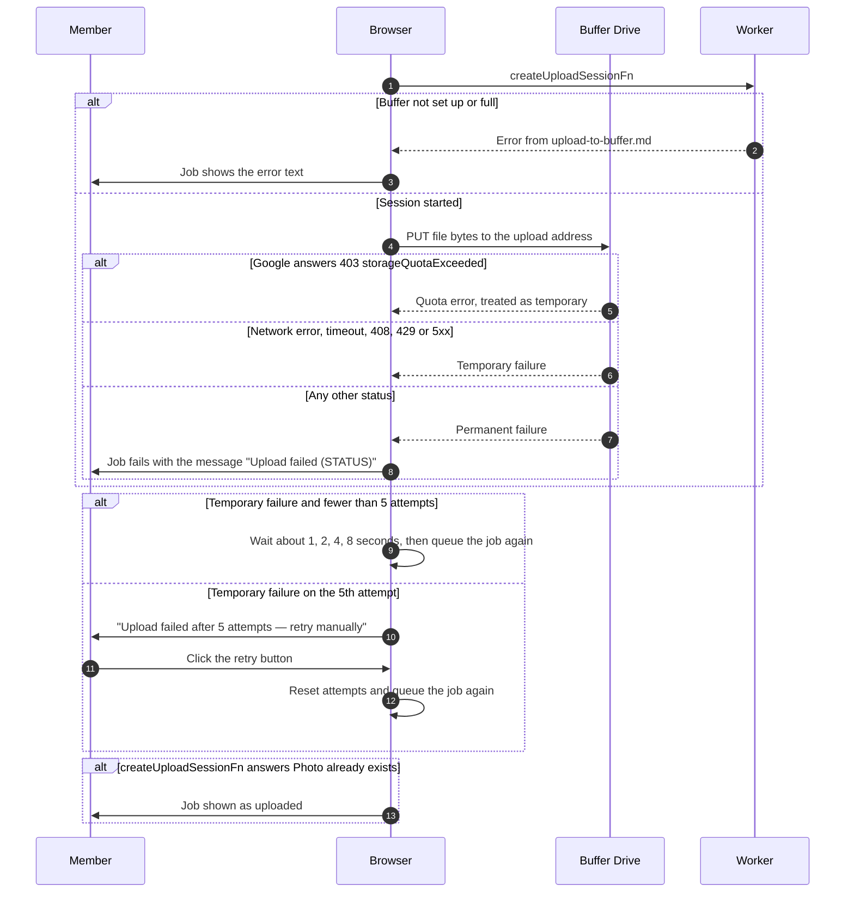

# Upload failures, retries and limits

> **Question:** What happens when a photo upload fails, and when does the browser retry on its own?
>
> **Answer:** If the transfer to Drive fails or is cancelled, the browser decides whether to retry. Network errors, timeouts, Google answers 408, 429 or 5xx, a quota error, a failed confirmation and a failed session request caused by a network error are temporary: the job goes back in the queue and waits about 1, 2, 4 then 8 seconds (plus or minus 20 percent), for at most 5 attempts in total. After that the list shows "Upload failed after N attempts — retry manually" with a retry button. Any other Google answer fails at once with the message "Upload failed (STATUS)", where STATUS is Google's status number. "Storage quota exceeded" from the PUT is retried like a temporary failure.
>
> **Notes:**
> - If the name already exists on the server when the session is requested (typically because an earlier attempt finished but its result was lost), the job is shown as done instead of failed.
> - The retry button restarts with a fresh attempt count. Choosing the same file again replaces the failed job.
> - Cancel aborts the transfer in progress and marks the job as cancelled (the list shows a tick labelled Cancelled).
> - If the confirm step fails 3 times, the file may sit in the buffer's Volume folder without a photo row, and the retry uploads the photo again as a second file.
> - If Google answers with success but the reply has no file id, the browser skips the confirm step and shows the job as done.
> - When the buffer is not set up or is full the session request fails with the message from upload-to-buffer.md and the job shows it as it is. There is no fallback to a flamekeeper.
> - Limits: files up to 5 GB (the Worker refuses larger sizes), 2 uploads at once, 5 attempts per job.

