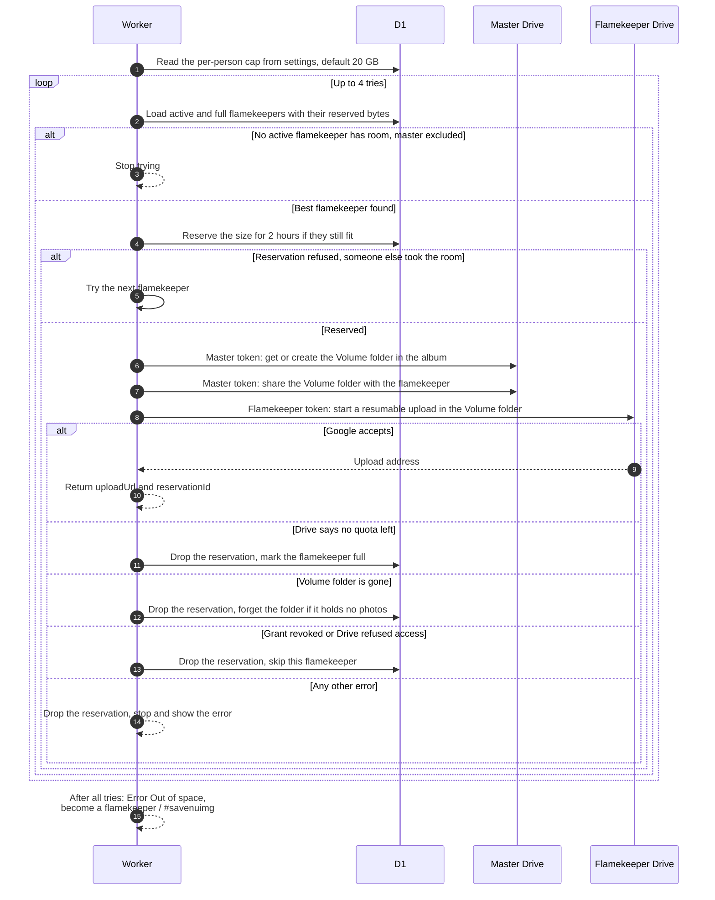

# Pick the flamekeeper that stores a photo

> **Question:** Which flamekeeper's Drive receives a photo, and what happens when none has room?
>
> **Answer:** For each photo the Worker picks the active flamekeeper with the most free room, never the master account, where free room is the smaller of what they pledged minus what they use and the per-person cap (default 20 GB) minus their Drive usage, both minus uploads already reserved. It reserves the photo's size for that person for 2 hours, makes sure the album has a "Volume" folder shared with them, and asks Google for a resumable upload address using the flamekeeper's own token. If nobody has room the member sees "Out of space, become a flamekeeper / #savenuimg".
>
> **Notes:**
> - The Volume folder lives inside the album folder in the master's Drive, is created with the master token and shared with the flamekeeper as editor. The file itself is created with the flamekeeper's token, so it counts against their Drive.
> - Up to 4 flamekeepers are tried per photo. A flamekeeper whose Drive reports no quota is marked full and skipped. One whose grant is revoked or whose folder is gone is skipped for this photo.
> - A vanished volume folder is only forgotten and recreated when that flamekeeper has no photos in the album, otherwise they are skipped to protect the photos.
> - The reservation only blocks space in the database. Google is not told in advance.
> - Pool rules and the per-person cap are in ../flamekeepers/admin-pool.md. Moving photos between flamekeepers is in ../flamekeepers/relay-move-photo.md.
> - Any other error from Google or the database while setting up a flamekeeper stops the search and is shown to the member as it is.
> - If two flamekeepers have the same free room, the one with the lower user id is chosen.

