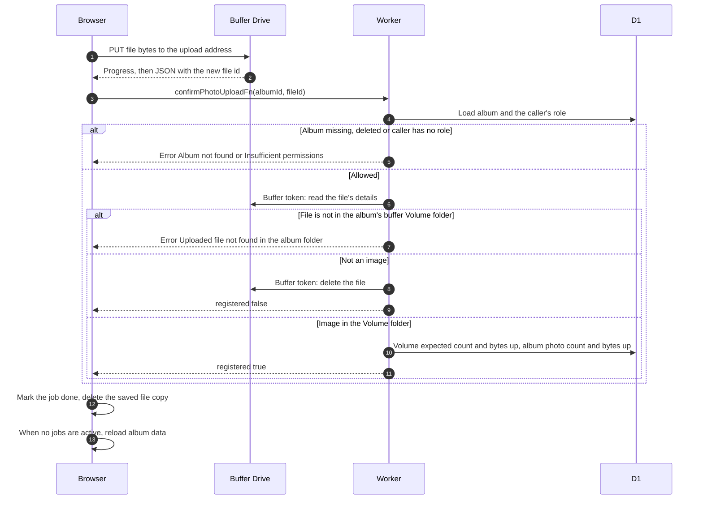

# Send a photo to Drive and confirm it

> **Question:** How does a photo get from the browser into the album once it has an upload address?
>
> **Answer:** The browser sends the file bytes directly to Google Drive with a PUT request to the upload address, showing progress. The bytes never pass through the Worker. When Google answers with the new file id, the browser calls the Worker to confirm. The Worker checks the file with the buffer's token, makes sure it sits in the album's buffer Volume folder and is an image, and adds one photo and its size to the volume's expected count and bytes and to the album's photo count and size. The upload list then shows "uploaded" and the album refreshes its page data.
>
> **Notes:**
> - A confirmation for a file the cached buffer listing already shows is accepted silently and adds nothing, so the counts are not raised twice. A complete listing of the album later replaces the album's count and size with the exact totals.
> - A file that is not an image is deleted from the buffer's Drive and not counted. The browser still shows it as done.
> - The browser retries the confirm call up to 3 times, waiting 0.5 s then 1 s. If all fail, the upload is treated as a temporary failure, see upload-failures.md.
> - Confirming changes the expected count and bytes, so a later album view lists the buffer again and shows the new photo without Refresh. While uploads keep arriving a view lists the buffer at most once every 5 minutes, and once no upload was confirmed for 30 seconds the next view lists it. The browser reloads the album once a whole batch is done. See [ADR-0017](../../adr/0017-drop-photo-table-read-from-drive.md).
> - Nothing is reserved or released: the buffer has no per-upload reservation. A file that does not reach Drive is handled as described in upload-failures.md.
> - There is no photo table. Deleting a photo finds its owner in the listing and, for the buffer, uses the buffer's token and lowers the expected count and bytes, see delete-photo.md.

