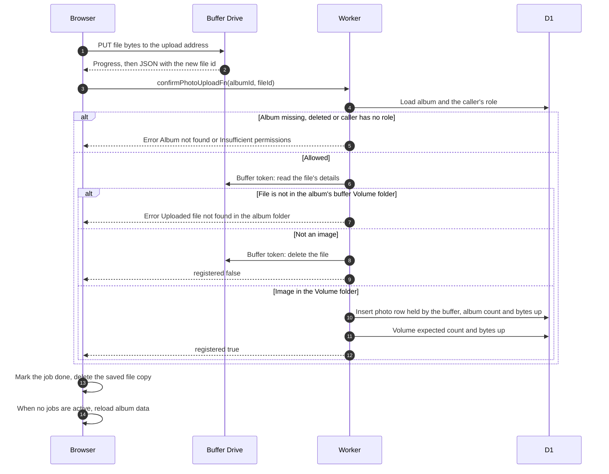

# Send a photo to Drive and confirm it

> **Question:** How does a photo get from the browser into the album once it has an upload address?
>
> **Answer:** The browser sends the file bytes directly to Google Drive with a PUT request to the upload address, showing progress. The bytes never pass through the Worker. When Google answers with the new file id, the browser calls the Worker to confirm. The Worker checks the file with the buffer's token, makes sure it sits in the album's buffer Volume folder and is an image, records it in the photo table as held by the buffer, and adds one photo and its size to the volume's expected count and bytes. The upload list then shows "uploaded" and the album refreshes its page data.
>
> **Notes:**
> - A confirmation for a photo that is already recorded is accepted silently and adds nothing, so the expected count is not raised twice.
> - A file that is not an image is deleted from the buffer's Drive and not recorded. The browser still shows it as done.
> - The browser retries the confirm call up to 3 times, waiting 0.5 s then 1 s. If all fail, the upload is treated as a temporary failure, see upload-failures.md.
> - The album page may keep showing the old photo list for a while, because the cached album copy is not cleared by confirming. Refresh clears it, see refresh-album.md.
> - Nothing is reserved or released: the buffer has no per-upload reservation. A file that does not reach Drive is handled as described in upload-failures.md.
> - The photo table marks buffer photos with the owner value `buffer` (photos held by a flamekeeper carry that user's id). Deleting such a photo uses the buffer's token and lowers the expected count and bytes.

