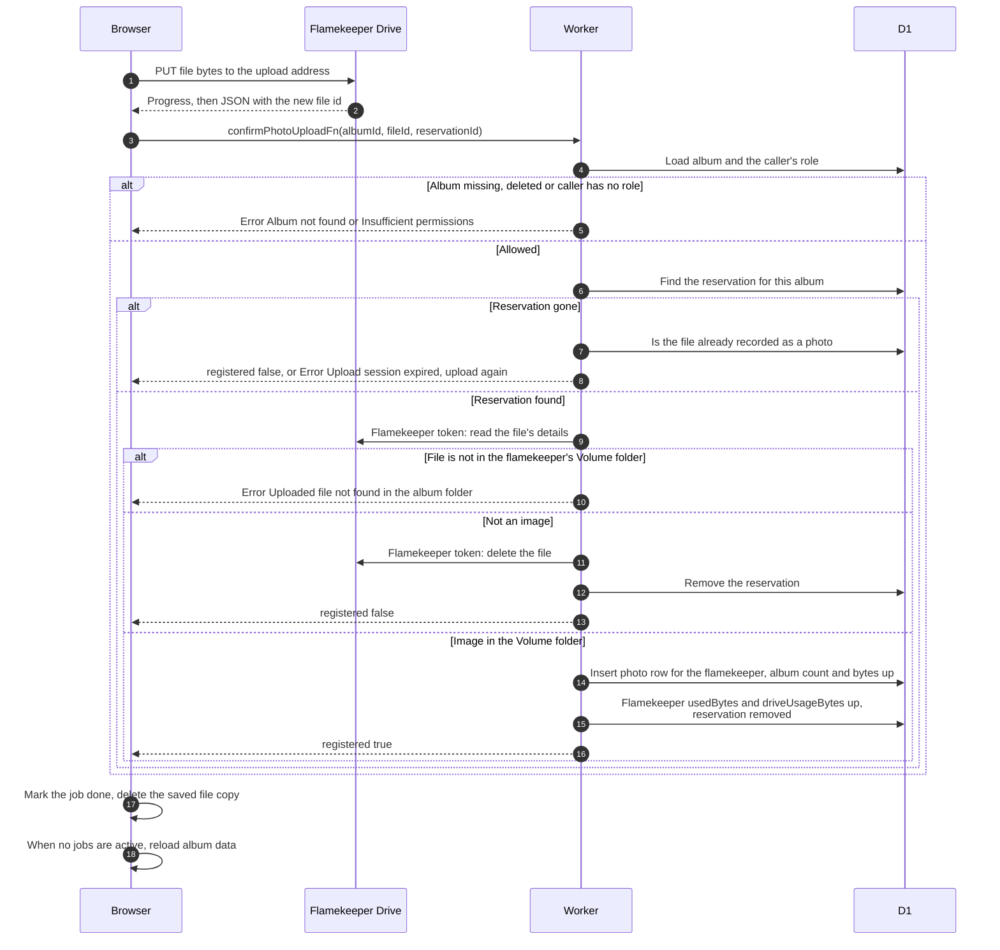

# Send a photo to Drive and confirm it

> **Question:** How does a photo get from the browser into the album once it has an upload address?
>
> **Answer:** The browser sends the file bytes directly to Google Drive with a PUT request to the upload address, showing progress. The bytes never pass through the Worker. When Google answers with the new file id, the browser calls the Worker to confirm. The Worker checks the file with the flamekeeper's token, makes sure it sits in that flamekeeper's Volume folder and is an image, records it in the photo table, adds its size to the flamekeeper's usage and removes the reservation. The upload list then shows "uploaded" and the album refreshes its page data.
>
> **Notes:**
> - A confirmation that arrives after the reservation is gone is accepted silently if the photo is already recorded (nothing new is added). Otherwise it fails with "Upload session expired, upload again".
> - A file that is not an image is deleted from the flamekeeper's Drive and not recorded. The browser still shows it as done.
> - The browser retries the confirm call up to 3 times, waiting 0.5 s then 1 s. If all fail, the upload is treated as a temporary failure, see upload-failures.md.
> - The album page may keep showing the old photo list for a while, because the cached album copy is not cleared by confirming. Refresh clears it, see refresh-album.md.
> - When a file does not reach Drive, the reservation is released as described in upload-failures.md.

