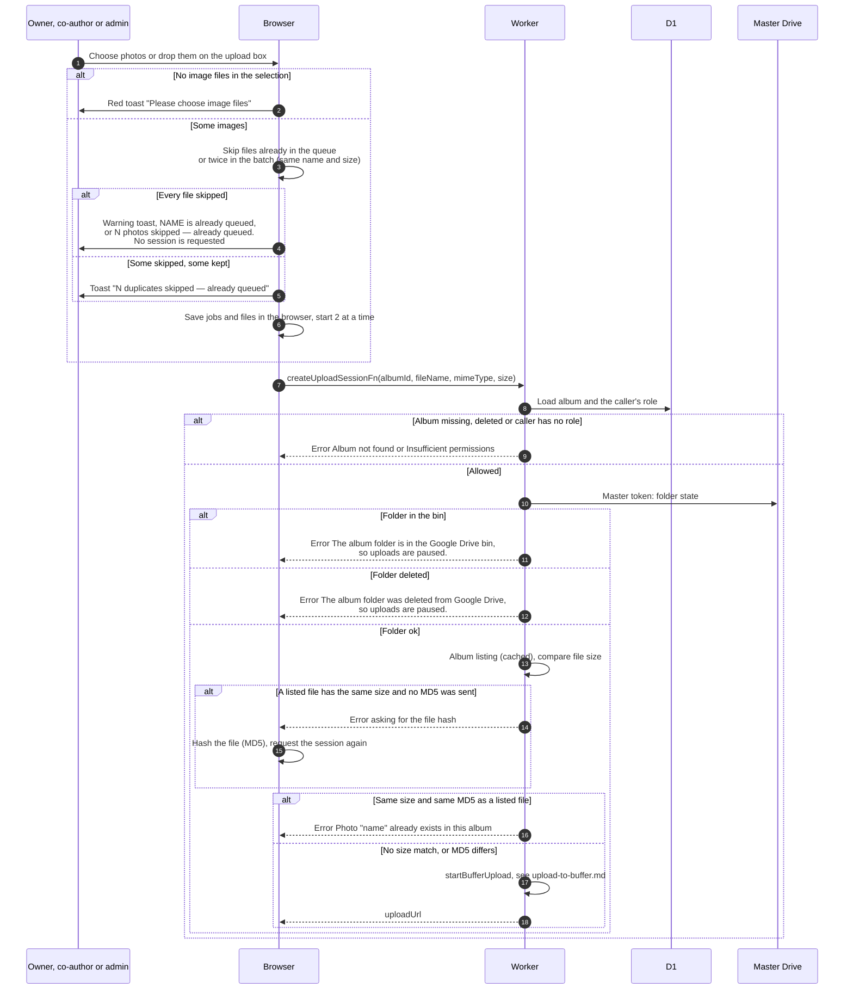

# Start uploading photos

> **Question:** What happens between choosing photos and the browser getting a Drive upload address for each one?
>
> **Answer:** The owner, co-authors and admins or managers choose image files or drop them on the upload box. The browser drops files already in the queue, saves the rest in a persistent queue, and works on 2 files at a time. For each file it asks the Worker for an upload session. The Worker checks the album folder is usable and the file is not a duplicate (size first, then MD5, see ADR-0017), then sets up the file's home on the buffer (see upload-to-buffer.md) and returns a one-time Google upload address. A file may be up to 5 GB.
>
> **Notes:**
> - The Upload photos button is disabled unless the folder state is ok, with the hover text "Uploads are paused while the album folder is in the bin or deleted". The page also shows a warning, see deleted-folder-warning.md.
> - The queue survives a page refresh: jobs go to localStorage and the files to IndexedDB. A job that was uploading is restarted from 0 after a refresh. A job whose file cannot be found fails with "File is no longer available — choose it again".
> - Finished jobs disappear after 1 hour (done or cancelled) or 7 days (failed).
> - Filenames are ignored. The Worker compares the file's size with the album's cached listing (see ADR-0017). Only when a listed file has the same size does the browser hash the file (MD5, in 4 MB slices) and retry; a matching MD5 refuses the upload as a duplicate, so a renamed copy is caught and a same-named different photo is not. Files with no size match are never hashed. The browser counts a file as an image if its type starts with image/ or is empty.
> - A rate limit named rl_create_upload_session (20 a minute) is declared in the project settings, but createUploadSessionFn does not use it.
> - Only a queued or uploading job with the same name and size blocks a new pick in the browser. A failed job with the same name and size is replaced instead. A duplicate refused by the Worker ends as done, since the photo is already in the album.
> - What the browser does next is in upload-send-and-confirm.md.

