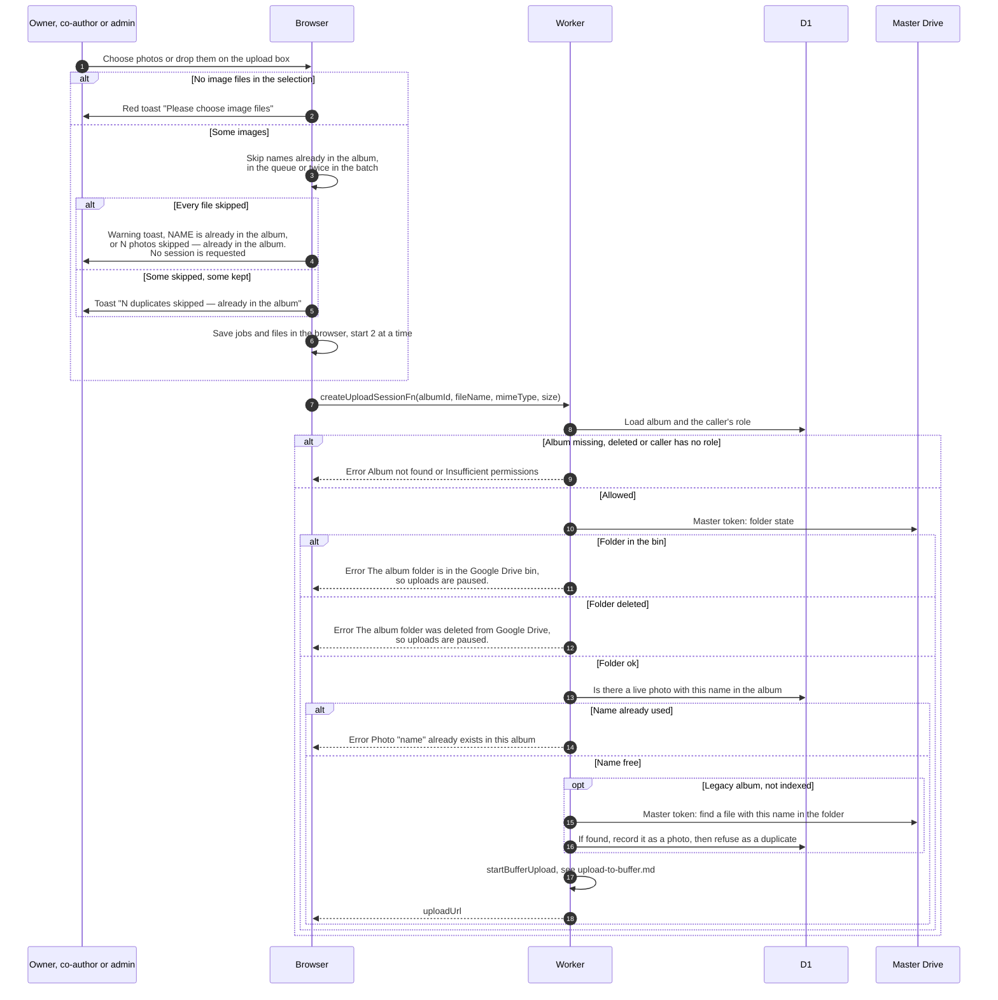

# Start uploading photos

> **Question:** What happens between choosing photos and the browser getting a Drive upload address for each one?
>
> **Answer:** The owner, co-authors and admins or managers choose image files or drop them on the upload box. The browser drops duplicates by name, saves the rest in a persistent queue, and works on 2 files at a time. For each file it asks the Worker for an upload session. The Worker checks the album folder is usable and the name is not taken, then sets up the file's home on the buffer (see upload-to-buffer.md) and returns a one-time Google upload address. A file may be up to 5 GB.
>
> **Notes:**
> - The Upload photos button is disabled unless the folder state is ok, with the hover text "Uploads are paused while the album folder is in the bin or deleted". The page also shows a warning, see deleted-folder-warning.md.
> - The queue survives a page refresh: jobs go to localStorage and the files to IndexedDB. A job that was uploading is restarted from 0 after a refresh. A job whose file cannot be found fails with "File is no longer available — choose it again".
> - Finished jobs disappear after 1 hour (done or cancelled) or 7 days (failed).
> - Names are compared exactly. The same name in the same album is refused by the browser and again by the Worker. The browser counts a file as an image if its type starts with image/ or is empty.
> - A rate limit named rl_create_upload_session (20 a minute) is declared in the project settings, but createUploadSessionFn does not use it.
> - Only a queued or uploading job of the same name blocks a new pick in the browser. A failed job with the same name is replaced instead.
> - What the browser does next is in upload-send-and-confirm.md.

