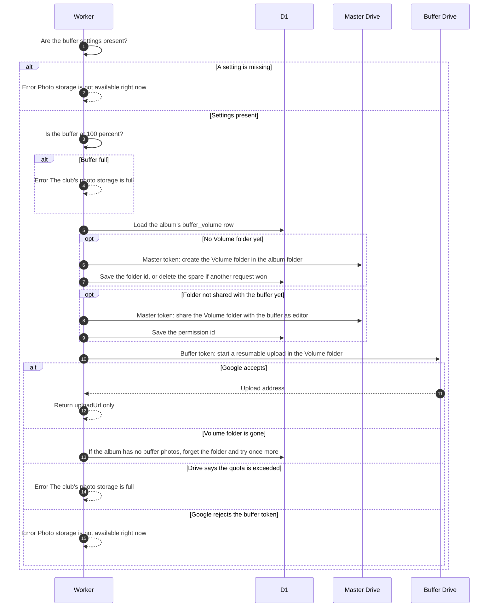

# Pick where a photo is stored

> **Question:** Whose Drive receives an uploaded photo, and what happens when that storage is unavailable?
>
> **Answer:** Every new photo goes to the buffer, the club-run Google account. The Worker makes sure the album has a Volume folder for the buffer, asks Google for a resumable upload address using the buffer's `drive.file` token, and returns only that address. No flamekeeper is ever chosen. If the buffer is not set up, its token stops working or its Drive is full, the upload fails with a plain message and nothing is placed anywhere else.
>
> **Notes:**
> - The Volume folder lives inside the album folder in the master's Drive. The master creates it, and shares it with the buffer as editor only on the first upload to that album, so the buffer is shared with only when it first receives files. One volume per album: its row in buffer_volume also stores the expected photo count and bytes.
> - The master account holds no photos. The file is created with the buffer's token, so it counts against the buffer's Drive, and it inherits the album folder's "anyone" reader permission.
> - The browser gets an upload address and nothing else. The buffer's `drive.file` token and its full-scope token (kept for drains, read only by src/lib/buffer/full-token.ts) never leave the Worker.
> - Messages: "Photo storage is not available right now, so uploads are paused. Please tell an admin." when GOOGLE_CLIENT_ID, GOOGLE_CLIENT_SECRET or GOOGLE_BUFFER_REFRESH_TOKEN is missing or Google rejects the buffer's token, and "The club's photo storage is full, so uploads are paused. Your photos are still on your device and nothing was lost. Please tell an admin." when the buffer is at 100% or Drive reports the quota exceeded. Setup is in the README, "Connecting the buffer account".
> - A Volume folder that has vanished from Drive is forgotten and recreated once, but only while the album has no buffer photos. Otherwise the upload stops with "The album storage folder could not be found in Google Drive, so uploads are paused."
> - Photos that flamekeepers already hold from before this change stay where they are. The old flamekeeper placement, reservations and pool figures still exist for the browser relay in ../flamekeepers/relay-move-photo.md until they are removed; uploads no longer use them.
> - Before asking Google for an address the Worker checks the buffer's cached usage (refreshed from Drive when older than 10 minutes). At 100 percent it refuses the upload with the full message. If usage cannot be read the upload goes ahead. See [../cron/flamekeepers/buffer-usage.md](../cron/flamekeepers/buffer-usage.md).

