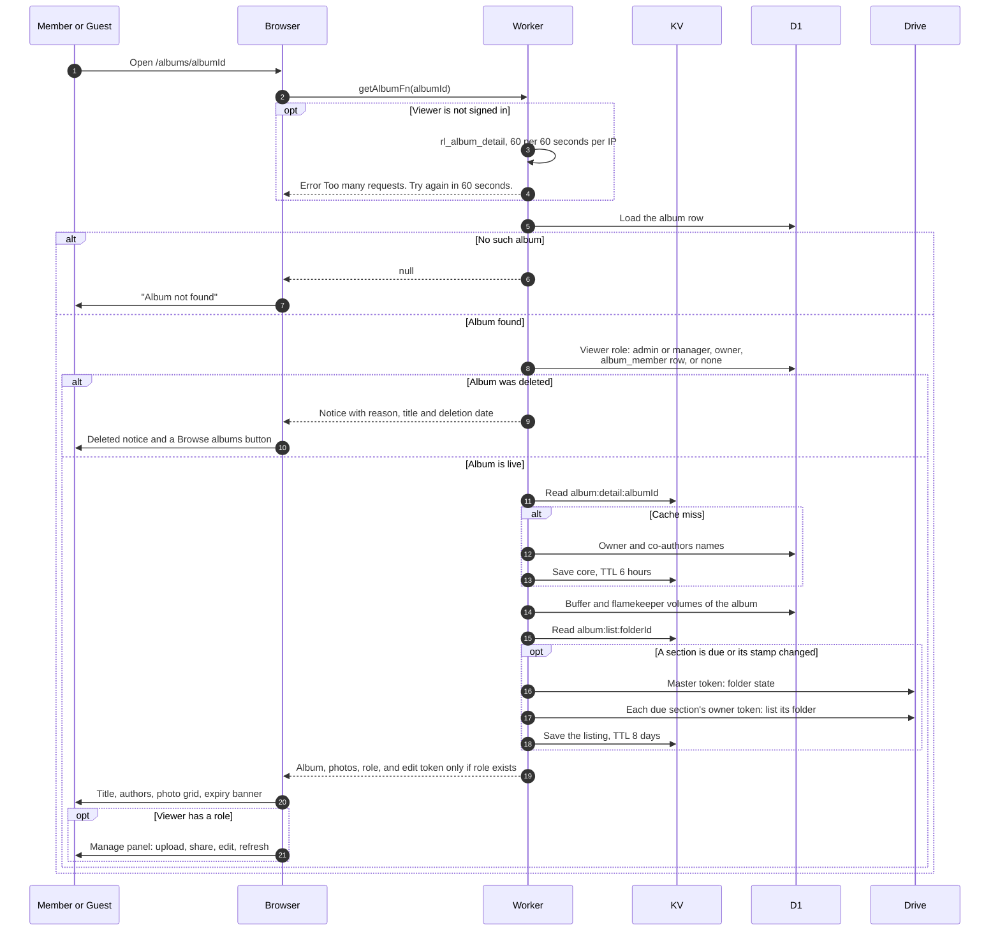

# Open an album page

> **Question:** What happens when someone opens an album link, signed in or not, and what do they see?
>
> **Answer:** Every album can be opened by anyone with the link, because all albums are public. The Worker works out the viewer's role (manager, owner, co-author or none) and returns the album with its photos. Guests are limited to 60 opens a minute per IP address, signed in users are not limited. The authors are cached for up to six hours and the photo list comes from a cached Drive listing, both shared by all viewers. Only people with a role get the edit link and the manage panel. A deleted album shows a "deleted" notice instead of photos, and an unknown id shows "Album not found".
>
> **Notes:**
> - Role per viewer is always checked fresh against the album row. The cover and expiry also come from the fresh row.
> - Core cache: 30 second memory copy per Worker instance in front of KV `album:detail:ALBUM_ID` with a 6 hour TTL. It is cleared by editing details, Refresh, deleting a photo, choosing a cover, joining or leaving as co-author, and deleting a gone album (see deleted-folder-warning.md). It no longer holds photos or folder health.
> - Photos and folder health (ok, trashed, missing) come from KV `album:list:FOLDER_ID`. A fresh entry means no Drive call. How long an entry stays fresh, and what happens when listing fails, is in [ADR-0017](../../adr/0017-drop-photo-table-read-from-drive.md).
> - Owners and admins also get a fewer-photos warning when a buffer Volume lists less than expected, built per viewer, see fewer-photos-warning.md.
> - A listing that fails never stops the page: the last listing is shown, or no photos if there is none yet.
> - If the album has no cover yet, the earliest uploaded photo becomes the cover. It is saved on the album only when the listing is complete.
> - The header always shows "Expires on DATE" for an unpinned album with an expiry (pinned albums show the Pinned badge instead). The page also shows a banner "Will be deleted on DATE" with "There is no backup. Download the photos you want to keep before then." once the expiry is within 30 days and the album is not pinned.
> - Photos load straight from Google's image servers: thumbnails at 600 px and full view at 1920 px. At most 6 images load at once, and a failed image is retried up to 5 tries, waiting 1, 2, 4 then 8 seconds.
> - Older albums are read the same way, see legacy-albums.md. Downloading is in download-photos.md.

