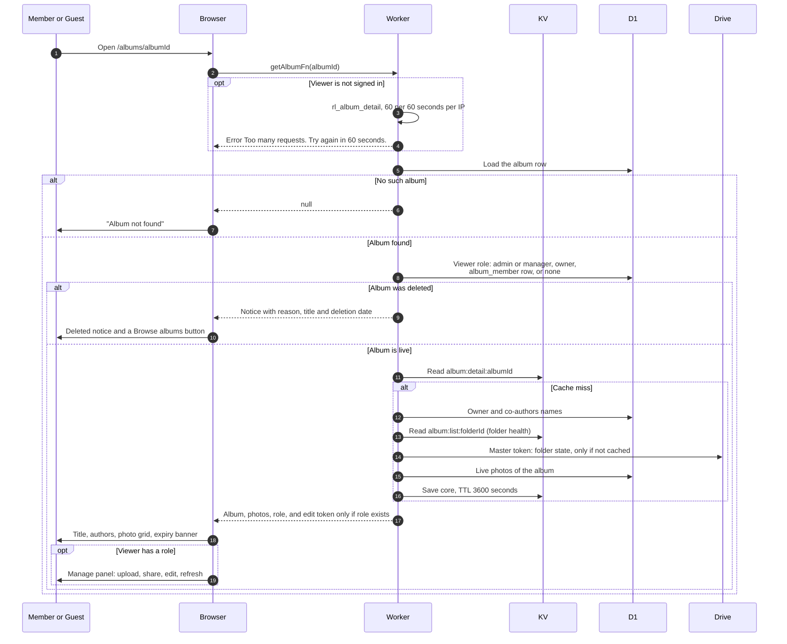

# Open an album page

> **Question:** What happens when someone opens an album link, signed in or not, and what do they see?
>
> **Answer:** Every album can be opened by anyone with the link, because all albums are public. The Worker works out the viewer's role (manager, owner, co-author or none) and returns the album with its photos. Guests are limited to 60 opens a minute per IP address, signed in users are not limited. The expensive part (photo list, authors, cover) is cached for up to an hour and shared by all viewers. Only people with a role get the edit link and the manage panel. A deleted album shows a "deleted" notice instead of photos, and an unknown id shows "Album not found".
>
> **Notes:**
> - Role per viewer is always checked fresh against the album row. Only the shared core is cached.
> - Core cache: 30 second memory copy per Worker instance in front of KV `album:detail:ALBUM_ID` with a 1 hour TTL. It is cleared by editing details, Refresh, deleting a photo, choosing a cover, joining or leaving as co-author, and deleting a gone album (see deleted-folder-warning.md). It is not cleared when an upload is confirmed, so new photos can take longer to appear unless Refresh is used, see refresh-album.md.
> - Folder health (ok, trashed, missing) is cached separately in KV `album:list:FOLDER_ID` for 5 minutes.
> - If the album has no cover yet, the earliest uploaded photo becomes the cover and is saved on the album.
> - The page shows a banner "Will be deleted on DATE" with "There is no backup. Download the photos you want to keep before then." once the expiry is within 30 days and the album is not pinned.
> - Photos load straight from Google's image servers: thumbnails at 600 px and full view at 1920 px. At most 6 images load at once, and a failed image is retried up to 5 tries, waiting 1, 2, 4 then 8 seconds.
> - The figures above are for albums whose photos are in the photo table. How photos are listed for old albums is in legacy-albums.md. Downloading is in download-photos.md.

