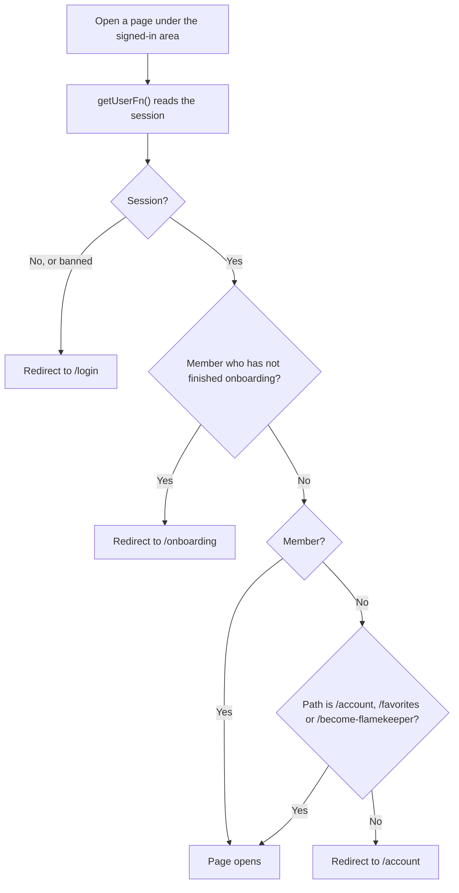

# Where a visitor lands

## What happens when someone opens a page in the signed-in area?

Login and `/onboarding` send people home with `homePath`: `/onboarding` for an unfinished member, `/equipment` for a member, `/account` for a non-member.

- `/albums` and `/about` are outside the gate and open for everyone.
- A non-member is never sent to onboarding. They join the club from `/account`, see [join club and onboarding](../member/account/join-club-and-onboarding.md).
- A banned user's sessions are deleted on the next check. Inactive and Alumni members are not blocked here.
- The server still runs the loaders and server functions' own checks. The redirects only shape the browser.
