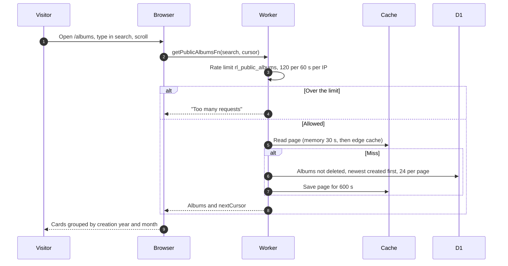
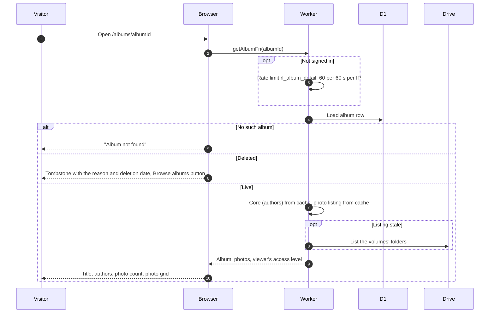
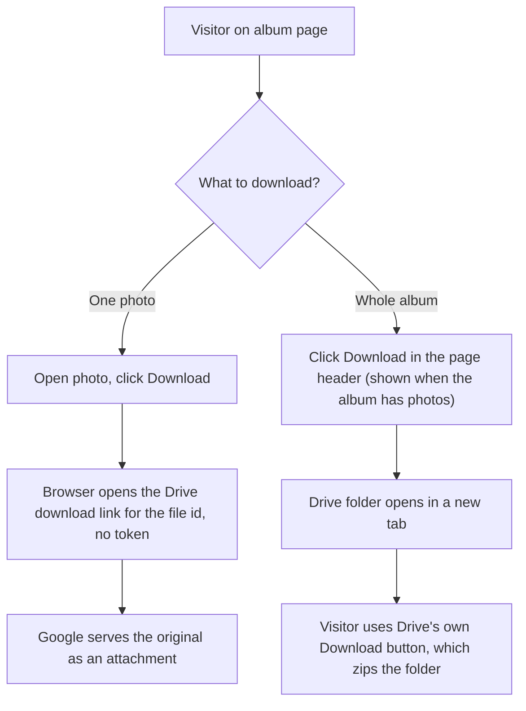

# Public albums

Anyone can browse and open albums without signing in. `/` redirects to `/albums`. Signed-in people see the same pages inside the app shell, guests inside a plain header with a Login button.

## How does the public album list load?

- Search matches title or description. There is no ownership filter on this list.
- Nothing clears the cache when albums change, so a new album can take up to 10 minutes to appear.
- Deleted albums (tombstones) are not listed.

## What does an album page show?

- Only an owner, co-author or album manager gets the edit token and manage panel, see [photos](../member/albums/photos.md).
- When the event is over two years old, a banner says the album may be deleted if storage runs low. Expiry and pinning are in the [GLOSSARY](../../../GLOSSARY.md).
- A failed Drive listing never breaks the page. It shows the last listing, or no photos.
- Photos load from Google's image servers (600 px thumbnails, 1920 px viewer).

## How does someone download photos?

The Worker is not involved. Album folders are always public ([ADR-0005](../../adr/0005-album-drive-folders-are-always-public.md)). Google offers no anonymous zip, so the folder link is the only whole-album download.
