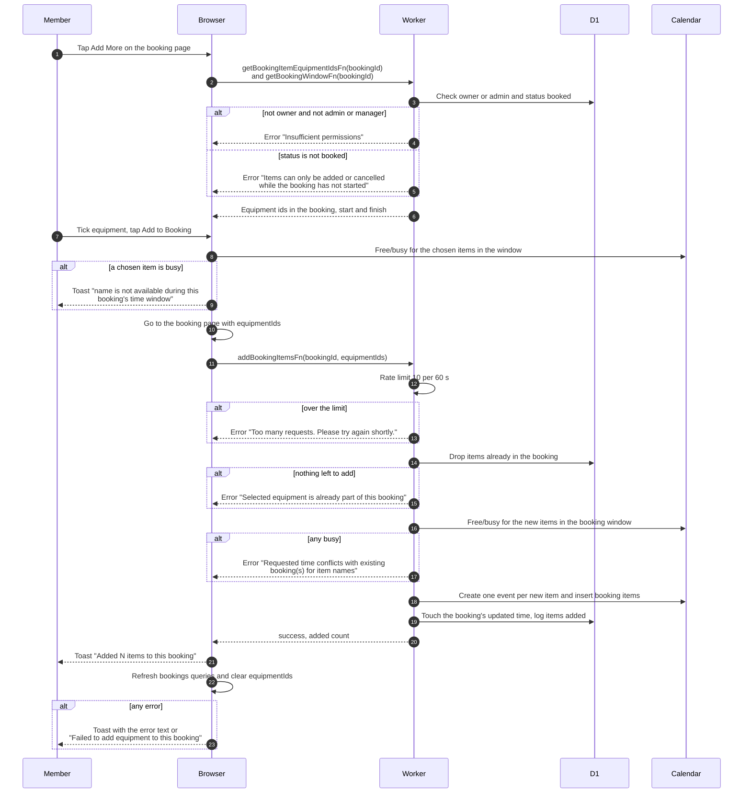

# Add equipment to an existing booking

> **Question:** How does a member add more equipment to a booking
> that has not started?
>
> **Answer:** From the booking page the member taps "Add More",
> ticks equipment in the catalog (items already in the booking are
> disabled) and taps "Add to Booking". The browser re-checks the
> booking's time window for the chosen items, returns to the booking
> page, and the server adds each new item with its own calendar
> event, using the booking's existing times. The member sees the
> toast "Added N items to this booking" and the page refreshes.
> This works only while the booking has status booked.
>
> **Notes:**
> - The owner can do this. An admin or manager can also do it for
>   someone else's booking, and the events then carry the owner's
>   name.
> - Rate limit: 10 requests per 60 seconds per signed-in person.
> - Items already in the booking are dropped from the request. If
>   that leaves nothing, the server refuses. The toast adds
>   "N already included" when only some were dropped.
> - A request carries 1 to 10 items. The server does not cap the
>   total number of items in the booking.
> - The two small lookups (current item ids and booking window) have
>   the same status and ownership checks as the add call.
> - A failed calendar write removes only the new items, see
>   create-booking-rollback.md. The booking stays.
> - The booking's own status does not change, because new items
>   start as booked.
> - The Telegram channel gets an "items added" post, see the
>   telegram folder.

