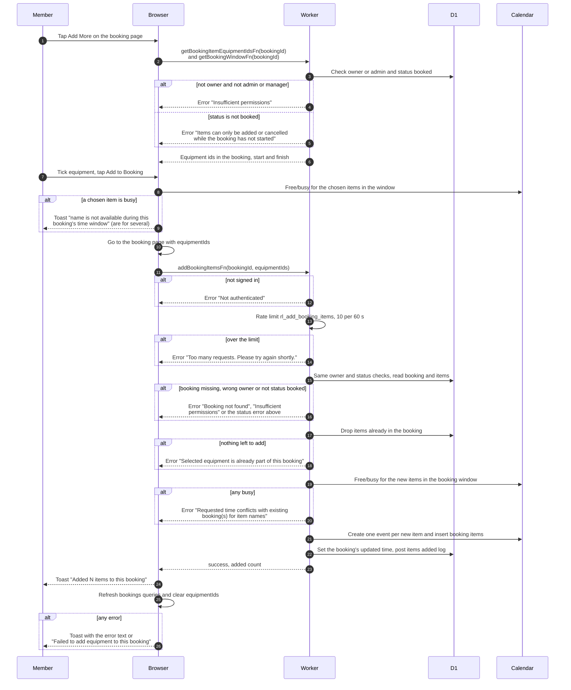

# Add equipment to an existing booking

> **Question:** How does a member add more equipment to a booking
> that has not started?
>
> **Answer:** On a booking that has not started, the member taps
> "Add More", ticks equipment in the catalog (items already in the
> booking are greyed out) and taps "Add to Booking". The browser
> checks the booking's time window for the chosen items and returns
> to the booking page. There the server adds each new item with its
> own calendar event, using the booking's existing times, and the
> member sees a toast such as "Added 2 items to this booking". Only
> bookings with status booked can be changed this way.
>
> **Notes:**
> - The owner can do this. An admin or manager can also do it for
>   someone else's booking, and the events then carry the owner's
>   name. Being a club member is not checked here.
> - Rate limit: 10 requests per 60 seconds per signed-in person. It
>   is checked before the booking is looked up. If the limiter
>   itself breaks, requests are let through.
> - Items already in the booking are dropped from the request. This
>   includes items that were cancelled earlier in the same booking.
>   If nothing is left, the server refuses. If only some were
>   dropped, the toast adds "K already included", with K the number
>   dropped. The word is "item" when N is 1.
> - A request carries 1 to 10 items. The server does not cap the
>   total number of items in the booking.
> - The two lookups the catalog page makes (items already in the
>   booking, and the booking window) run the same ownership and
>   status checks as the add call. If one fails, the page logs it
>   and shows the catalog without greying out items.
> - A failed calendar write removes only the new items, see
>   create-booking-rollback.md. The booking stays.
> - The booking's own status does not change, because new items
>   start as booked.
> - The Telegram channel gets an "items added" post, see
>   ../telegram/channel-log.md.

