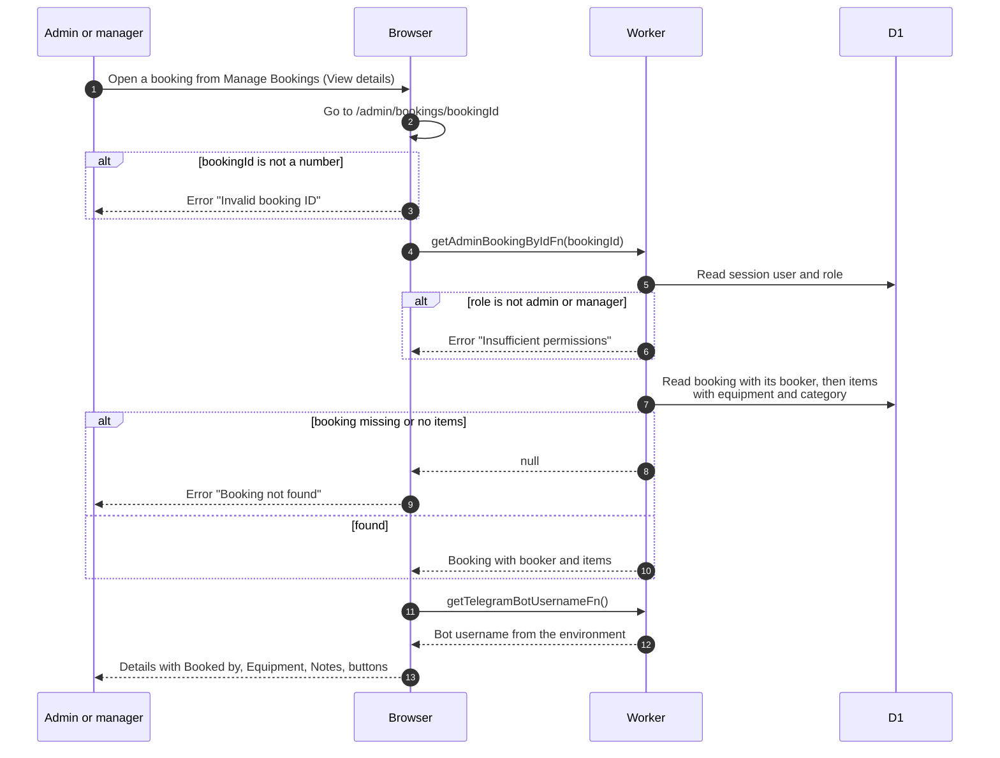

# Booking details page (admin)

> **Question:** What does an admin see when they open any member's
> booking?
>
> **Answer:** The same "Booking #id" page as the member, with an
> extra "Booked by" row that links to the member's profile in the
> admin console. An admin or manager can open any booking. A missing
> booking, or one with no items, fails with "Booking not found".
> Buttons depend on status like the member page, except that there
> is no Start Pickup button, and Cancel Booking runs the admin
> cancel.
>
> **Notes:**
> - Buttons: booked gives Edit Booking, Cancel Booking, Add More
>   and Cancel item. Booked, active, partially returned and overdue
>   give Add 30 min. Active, partially returned and overdue give
>   Return Booking, which opens the Telegram bot as in
>   return-booking.md.
> - Cancel Booking here uses the admin function, so the Telegram
>   post names the admin, see admin-cancel-booking.md.
> - Add 30 min and item cancel use the same functions as members,
>   see extend-booking.md and cancel-item.md.
> - The member version is booking-details.md.

