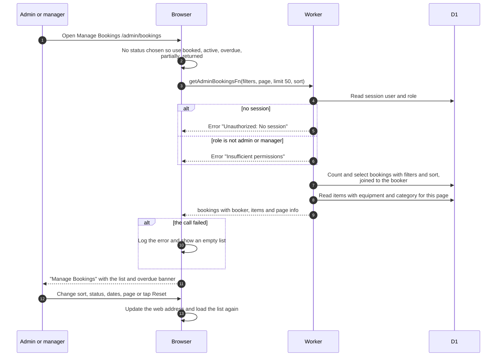

# Manage Bookings list (admin)

> **Question:** What does an admin or manager see on Manage
> Bookings?
>
> **Answer:** A paged list of every member's bookings with the
> booker's name, email and photo, and the items. Like the member
> list it hides returned and cancelled bookings until a status
> filter is chosen, and it keeps sort, filters and page in the web
> address. Only admins and managers can load it. Anyone else gets
> an empty list because the load error is logged and ignored.
>
> **Notes:**
> - Sort choices on this page: start time (default), end time,
>   status, created time. The server also supports sorting by the
>   booker's email and by equipment name, but the page does not
>   offer them.
> - Page size is 50 by default, at most 100.
> - A banner at the top counts overdue bookings.
> - The booker's name links to the user page in the admin console.
> - Row actions lead to admin-booking-details.md,
>   admin-edit-booking.md and admin-cancel-booking.md.
> - Date filters work the same way as in my-bookings-list.md.

