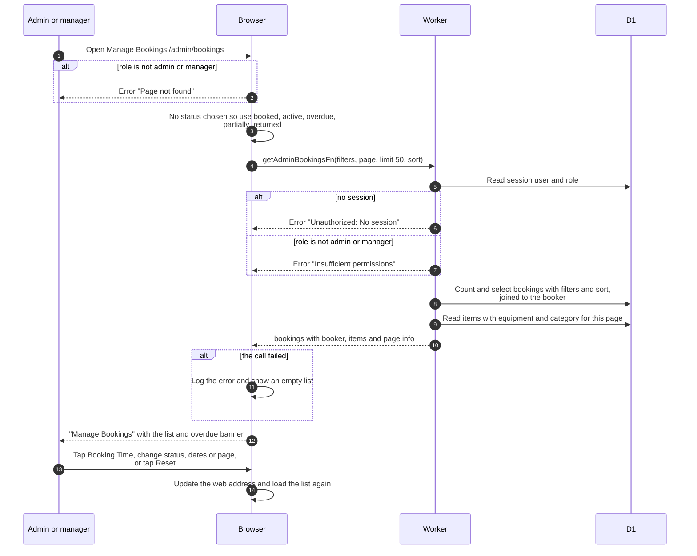

# Manage Bookings list (admin)

> **Question:** What does an admin or manager see on Manage
> Bookings?
>
> **Answer:** A paged list of every member's bookings with the
> booker's name, email and photo, and the items. Like the member
> list it hides returned and cancelled bookings until a status
> filter is chosen, and it keeps sort, filters and page in the web
> address. Only admins and managers can open the page. Anyone else
> sees a "Page not found" error before the list is asked for.
>
> **Notes:**
> - The page has one sort button, Booking Time, which flips the
>   start time between oldest first (default) and newest first. The
>   address can also carry end time, status or created time. The
>   server can sort by the booker's email and by equipment name too,
>   but this page's address rules do not accept those.
> - Page size is 50 by default, at most 100.
> - A red banner at the top counts bookings on the shown page that
>   are active or partially returned and past their finish time.
> - Each row can be ticked, and "Cancel Selected" cancels the
>   ticked bookings, see admin-cancel-booking.md.
> - The booker's name links to the user page in the admin console.
> - Row actions lead to admin-booking-details.md,
>   admin-edit-booking.md and admin-cancel-booking.md.
> - Date filters work the same way as in my-bookings-list.md.

