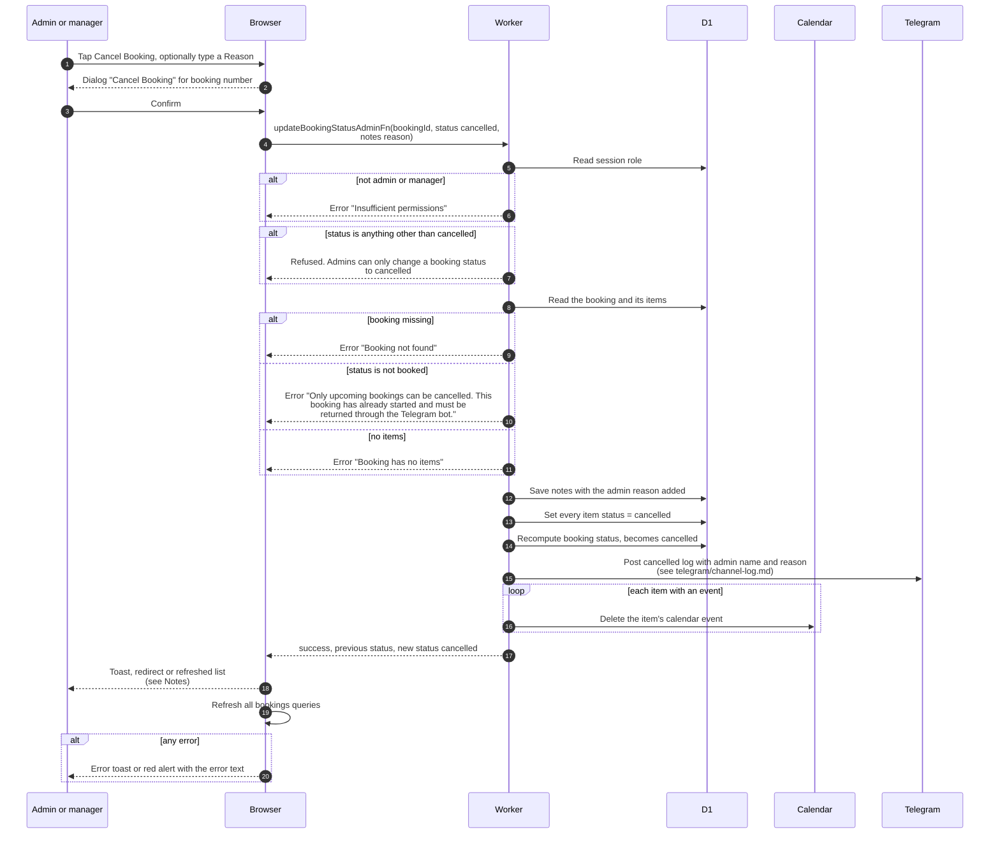

# Cancel a booking (admin) and admin status rules

> **Question:** What can an admin cancel, and which statuses can an
> admin set?
>
> **Answer:** The only status an admin can set is cancelled, and only
> on a booking that is still booked. Any other status value is
> refused: active, returned, overdue and partially returned are set
> by the system when a booking starts, is returned or runs late. An
> admin or manager cancels from the list, the booking page, the edit
> page, or "Cancel Selected" for several bookings. The server marks
> every item cancelled, sets the booking to cancelled, posts to the
> Telegram channel naming the admin with the reason, and deletes the
> calendar events.
>
> **Notes:**
> - The edit page and list dialog offer an optional "Reason". If it
>   is left empty, the text "Booking cancelled by admin" is sent.
>   The reason is added under the member's notes as "[Admin Note by
>   name]: reason". The booking page and bulk cancel send no reason,
>   so the notes stay as they were.
> - Success feedback differs. The booking page shows the toast
>   "Booking cancelled successfully". The edit page goes back to
>   Manage Bookings. The list dialog refreshes the list. Bulk cancel
>   shows "Cancelled N bookings" and "Some bookings could not be
>   cancelled" for failures. Bookings not in booked status are
>   skipped by the bulk button. Errors show as a toast on the list
>   and the booking page, and as a red message on the edit page.
> - The channel post is described in ../telegram/channel-log.md.
> - Calendar delete, post and status recompute failures are only
>   logged, as in cancel-booking.md.
> - Fixing a started booking is done through the Telegram return,
>   see return-booking.md.

