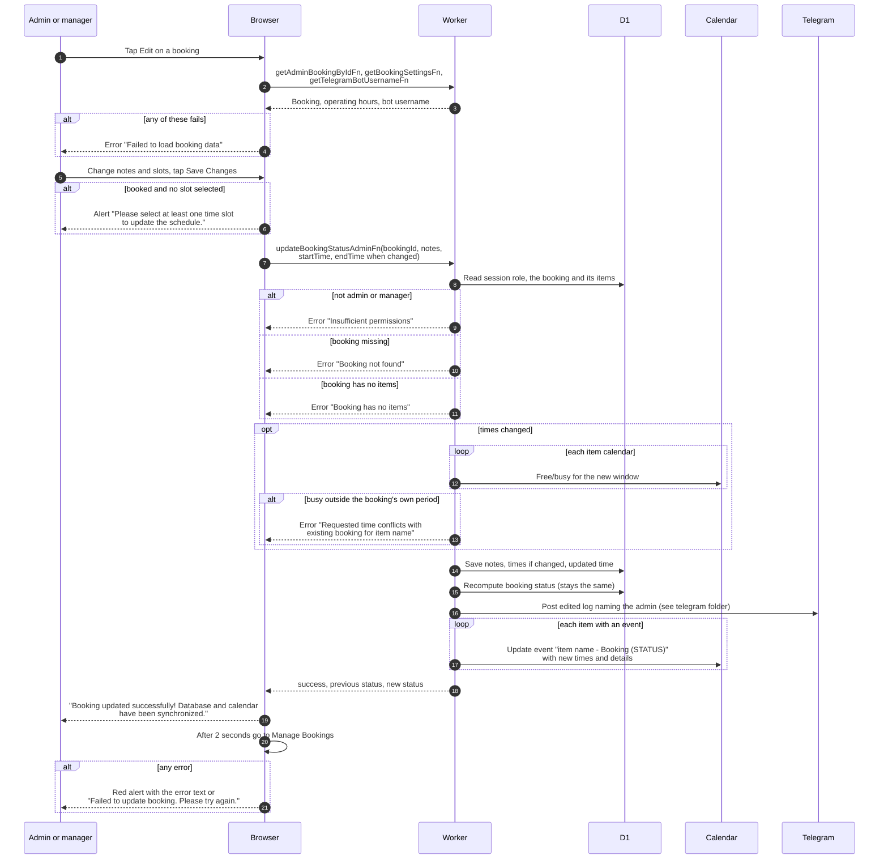

# Edit a booking (admin)

> **Question:** What happens when an admin changes a booking's
> notes or time?
>
> **Answer:** On the admin Edit Booking page the admin edits the
> notes and, while the booking is still booked, picks new slots,
> then taps "Save Changes". The server checks no other booking is
> busy on the items' calendars for the new window, saves the notes
> and times, posts an "edited" message naming the admin, and
> updates each item's calendar event. The page shows "Booking
> updated successfully! Database and calendar have been
> synchronized." and goes back to Manage Bookings after 2 seconds.
>
> **Notes:**
> - Times are sent only if they differ from the saved ones, so a
>   notes-only save skips the availability check.
> - Unlike the member edit, there is no 1 hour advance check and no
>   48 hour, 60 day or operating hours check.
> - Notes are replaced as a whole. An empty note is saved as empty.
> - The server does not require status booked. The page shows the
>   schedule picker only for booked bookings, but the notes box is
>   always editable.
> - The event title keeps the status at the time of saving, for
>   example "item name - Booking (ACTIVE)". See
>   calendar-event-titles.md.
> - Overdue banner: for active or partially returned bookings whose
>   finish time has passed, the page shows "This booking is
>   overdue!" with the due date.
> - The page also has Cancel Booking, Add 30 min, Add More and
>   Cancel item. See admin-cancel-booking.md, extend-booking.md,
>   add-items.md and cancel-item.md.

