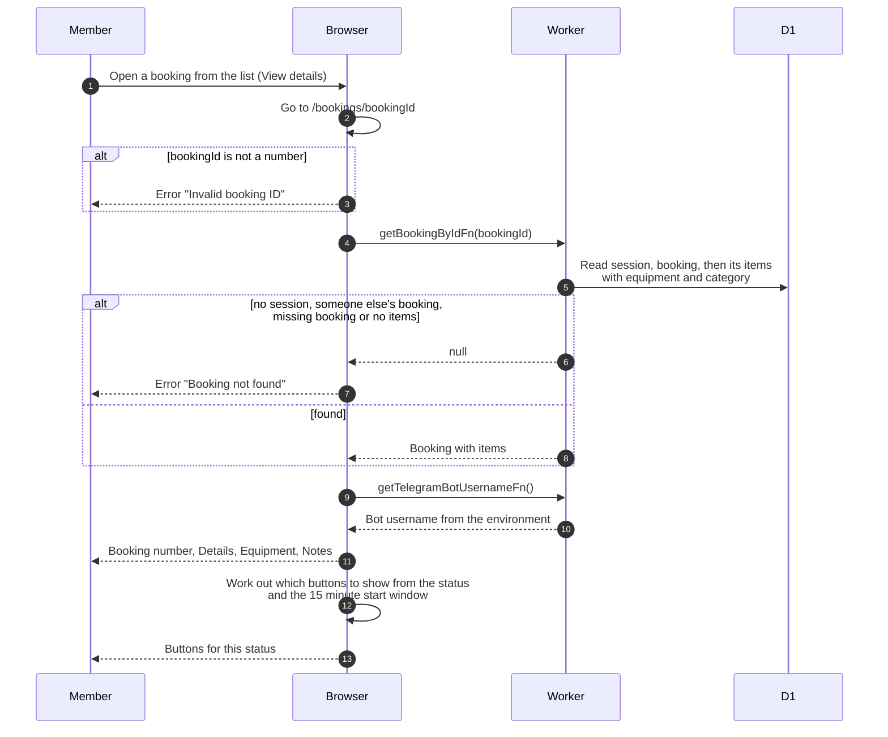

# Booking details page (member)

> **Question:** What does a member see when they open one of their
> bookings, and which buttons appear?
>
> **Answer:** The page "Booking #id" shows the details table, the
> equipment with a per-item action, and the notes. A booking that is
> not the member's own, or that does not exist, or that has no items,
> fails to load with the error "Booking not found". Which buttons
> show depends on the booking status, and on the clock for the start
> button.
>
> **Notes:**
> - Buttons by status. booked: Edit Booking, Cancel Booking, Add
>   More equipment, Cancel item on each row. booked and inside the
>   start window: also Start Pickup. booked, active, partially
>   returned, overdue: Add 30 min. active, partially returned,
>   overdue: Return Booking (needs the bot username). Returned and
>   cancelled bookings only show the details.
> - Start window: from 15 minutes before the booked start to 15
>   minutes after it, and only while the booking has not started.
> - The page is built when opened. A booking whose window opens
>   later keeps its old buttons until the page is reloaded.
> - Status badges are colored from the stored status. The admin
>   version of this page is admin-booking-details.md.
> - Each button has its own file: start-booking.md,
>   cancel-booking.md, cancel-item.md, add-items.md, edit-booking.md,
>   extend-booking.md, return-booking.md.

