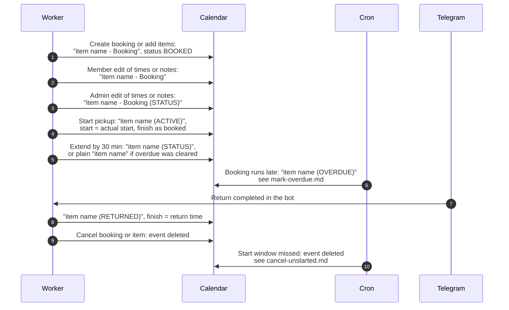

# Calendar event titles through a booking's life

> **Question:** What is the title of an item's calendar event at
> each step of a booking?
>
> **Answer:** Each item has its own event in its equipment's
> calendar. It is created as "item name - Booking" and then renamed
> as the booking moves: "(ACTIVE)" on start, "(OVERDUE)" when late,
> "(RETURNED)" on return. Cancelling deletes the event instead of
> renaming it. The description lists booking number, user,
> equipment, booked time, actual start and return when known,
> status in capitals and notes.
>
> **Notes:**
> - "item name" is the equipment model name, or "Equipment id"
>   when it has none.
> - Edits by the member always write "item name - Booking", even
>   if the booking is no longer booked. Admin edits write "item
>   name - Booking (STATUS)" with the current status in capitals.
> - Extending writes "item name (STATUS)" with the current status.
>   When the extension clears an overdue booking, the title is the
>   plain item name with no suffix.
> - Event times are in club time (Asia/Almaty). The overdue event
>   is written in UTC instead, which shows the same moment.
> - The start time of an event is the actual start once the
>   booking started, otherwise the booked start. The finish is the
>   booked finish, or the real return time after a return.
> - Overdue marking is in ../cron/bookings/mark-overdue.md and the
>   auto-cancel is in ../cron/bookings/cancel-unstarted.md. The
>   return is in return-booking.md.

