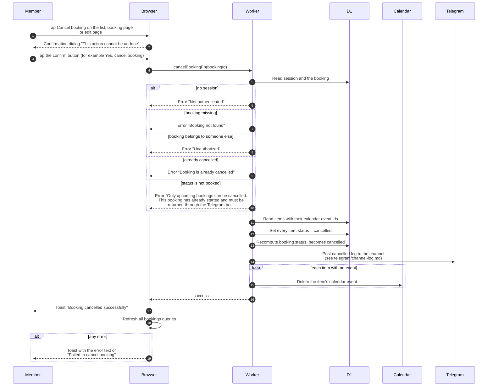

# Cancel a whole booking (member)

> **Question:** What happens when a member cancels a booking?
>
> **Answer:** The member confirms in a dialog, from the My Bookings
> list, the booking page, the edit page, or the "Cancel Selected"
> button for several bookings at once. The server checks that the booking is
> theirs and still has status booked, marks every item cancelled,
> sets the booking to cancelled, posts to the Telegram channel and
> deletes each item's calendar event. The member sees the toast
> "Booking cancelled successfully" and the lists refresh. A booking
> that has already started cannot be cancelled here and has to be
> returned through the Telegram bot.
>
> **Notes:**
> - Database changes come first, then the Telegram post, then the
>   calendar deletes. A failed status recompute, post or calendar
>   delete is only logged and does not stop the rest, so the
>   equipment is freed even if the post fails.
> - A failed calendar delete leaves that event on the equipment
>   calendar. It is not retried.
> - Bulk cancel opens the dialog "Cancel selected bookings?" and
>   sends one call per ticked booking at the same time. Only
>   bookings with status booked are included, and the dialog says
>   the others "will be skipped". It shows "Cancelled N bookings"
>   for the successes and "Some bookings could not be cancelled"
>   with "Failed to cancel N booking(s)." for the rest. The button
>   stays disabled until a booked booking is ticked.
> - The dialog wording depends on the page. The list uses "Cancel
>   Booking?" and "Yes, cancel booking". The booking page uses
>   "Keep Booking" and "Cancel Booking". The edit page uses "No,
>   keep it" and "Yes, cancel booking".
> - The edit page toast reads "Booking cancelled successfully!" and
>   it goes back to My Bookings after 1.5 seconds. The other pages
>   stay where they are and refresh.
> - Cancelling one item only is cancel-item.md. Cancelling by an
>   admin is admin-cancel-booking.md.
> - The auto-cancel of unstarted bookings by the clock is in
>   ../cron/bookings/cancel-unstarted.md.

