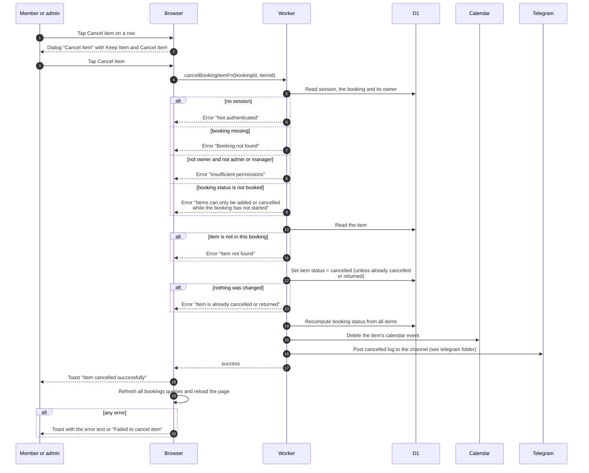

# Cancel one item of a booking

> **Question:** What happens when someone cancels a single piece of
> equipment from a booking?
>
> **Answer:** On a booking that is still booked, "Cancel item" on a
> row opens the dialog "Cancel Item". On "Cancel Item" the server
> marks that one item cancelled, deletes its calendar event, and
> recalculates the booking status. The other items stay booked. If
> it was the last live item, the whole booking becomes cancelled.
> The person sees the toast "Item cancelled successfully" and the
> page refreshes.
>
> **Notes:**
> - The booking's owner can do this. An admin or manager can too.
> - The server checks the item belongs to the booking in the web
>   address, otherwise "Item not found".
> - The booking status is derived from its items: all cancelled
>   gives cancelled, all returned gives returned, any overdue gives
>   overdue, a mix of returned and live gives partially returned,
>   any active gives active, otherwise booked.
> - The Telegram channel post uses the same "cancelled" event as a
>   whole booking cancel. See the telegram folder.
> - Cancelling items is also available from the Telegram command
>   /cancel_booking, which uses the same item logic, see telegram
>   folder.
> - A failed calendar delete is only logged and the event stays.

