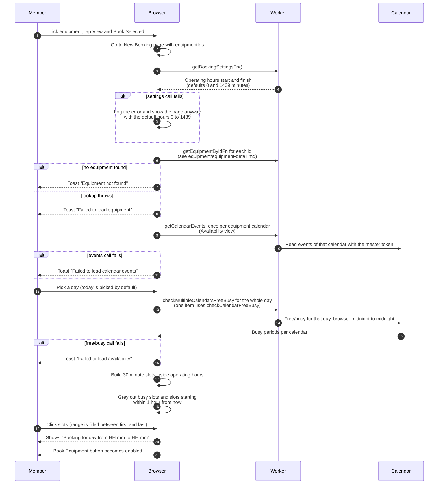

# Choose equipment and a time slot

> **Question:** How does a member pick equipment and a time slot,
> and which times can they pick?
>
> **Answer:** The member ticks equipment in the catalog and taps
> "View & Book Selected", which opens the New Booking page. The page
> loads the club's operating hours, shows each item's calendar, and
> lets the member pick one day and a run of 30 minute slots. Slots
> outside operating hours, slots that overlap a busy period on any
> chosen item's calendar, and slots starting less than an hour from
> now are greyed out and cannot be clicked. "Book Equipment" stays
> disabled until at least one slot is picked.
>
> **Notes:**
> - Operating hours are stored as minutes since midnight in club
>   time. A slot is offered only if it starts at or after the opening
>   minute and finishes at or before the closing minute.
> - The picker works on one calendar day, so a booking made here
>   can never pass 24 hours. The 48 hour limit and the 60 day limit
>   are checked only by the server, in create-booking.md.
> - The calendar widget blocks days before today but has no upper
>   limit, so a day over 60 days away can be picked and is refused
>   later by the server.
> - Picking slots fills the gap: the booking runs from the first
>   picked slot to 30 minutes after the last picked slot.
> - The selection is kept in the browser under the key
>   equipment-selection. The server does not store it.
> - The busy check for the picked day uses the browser's own
>   midnight to midnight, not club time. Today is picked when the
>   page opens, and the Today and Tomorrow buttons jump to those
>   days. The catalog is in ../equipment/select-and-book.md and
>   the equipment lookup is in ../equipment/equipment-detail.md.
> - Every Google call here uses the master token and needs a
>   signed-in person. Busy checks go to Google at most 15
>   calendars at a time.
> - The page can also remove an item (Remove) or go back to the
>   catalog (Add More). Removing the last item returns to the
>   catalog.
> - The club's booking note is not shown on this page.
> - Next step: create-booking.md.

