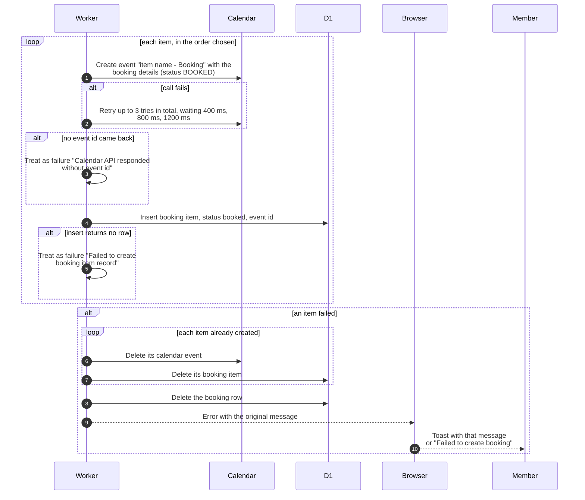

# Create a booking: calendar events and rollback

> **Question:** What happens if Google Calendar fails halfway
> through creating a booking with several items?
>
> **Answer:** For each item the server creates a calendar event and
> then saves the booking item. A failed event call is tried up to 3
> times. If an item still fails, the server deletes every event it
> already made for this booking, deletes the booking items, then
> deletes the booking itself, and the member sees the error text
> as a toast. The member ends up with no booking and the equipment
> calendars are left as they were.
>
> **Notes:**
> - Retry waits: 400 ms after the first failure, 800 ms after the
>   second, 1200 ms after the third. The error shown is the last one.
> - If the event is made but the item row cannot be saved, that
>   one event is not in the rollback list and stays in the
>   calendar.
> - Each rollback step is attempted on its own. If a calendar delete
>   or a database delete fails, it is only logged and the rest of
>   the rollback goes on. A leftover event is then possible.
> - Every event is created in the item's own equipment calendar,
>   in club time (Asia/Almaty), titled "item name - Booking".
> - The same code adds items to an existing booking, see
>   add-items.md. There, a failure removes only the new items and
>   the booking stays.
> - The conflict check before this step is in create-booking.md.

