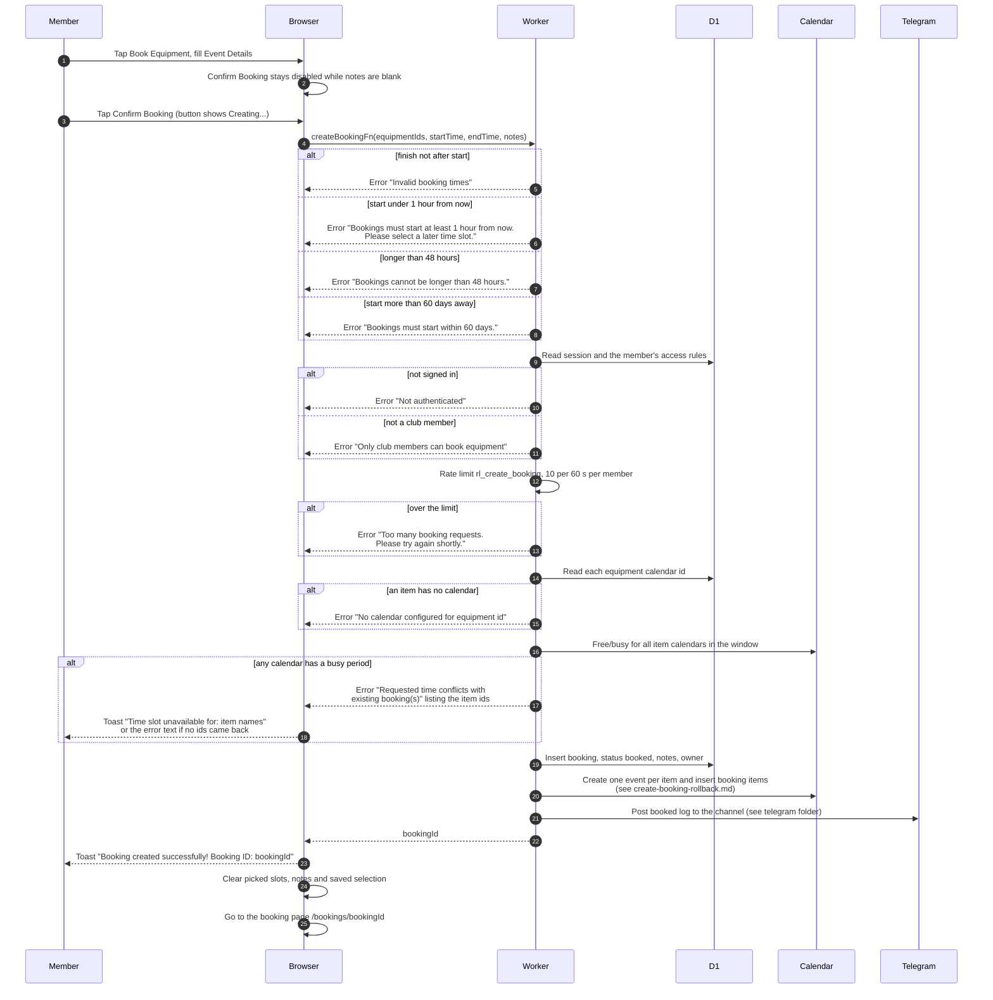

# Create a booking

> **Question:** What happens when a member confirms a new booking?
>
> **Answer:** The member fills in Event Details (required in the
> dialog) and taps "Confirm Booking". The server checks the times,
> that the person is a club member, and that they are under the
> rate limit, then asks Google Calendar whether every chosen item is
> free. If so it saves one booking with status booked, adds one
> booking item and one calendar event per piece of equipment, posts
> to the Telegram channel, and the member lands on the booking's
> page with a success toast. Any failed check shows an error toast
> and nothing is saved.
>
> **Notes:**
> - Time rules checked first, before sign-in: finish after start,
>   start at least 1 hour from now, length at most 48 hours, start
>   within 60 days.
> - Operating hours are not checked here. They are enforced only by
>   the slot picker in choose-equipment-and-time.md.
> - Rate limit: 10 creations per 60 seconds per member. If the
>   limiter itself breaks, requests are let through.
> - One request can carry 1 to 10 items. Repeated ids are merged.
>   Notes are optional for the server and at most 500 characters.
> - Event titles and what happens if calendar writes fail are in
>   create-booking-rollback.md. Titles at every step are in
>   calendar-event-titles.md.
> - The Telegram channel post is described in the telegram folder.
>   A failed post is only logged and does not stop the booking.

