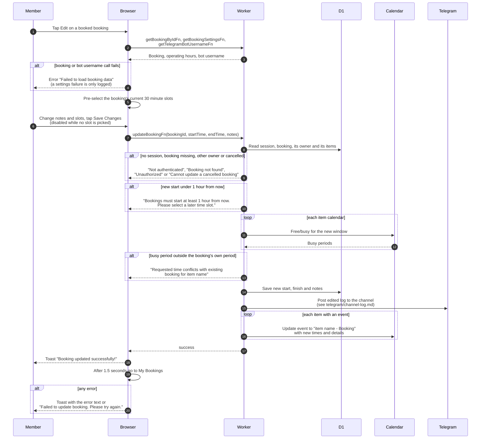

# Edit a booking (member)

> **Question:** What happens when a member changes the time or the
> notes of a booking?
>
> **Answer:** On the Edit Booking page of a booking that is still
> booked, the member changes the notes and picks new slots, then taps
> "Save Changes". The server checks the new start is at least 1 hour
> away and that no other booking is busy on any of the items'
> calendars, saves the new times and notes, and renames and moves
> each item's calendar event. The button stays disabled until at
> least one slot is picked. The member sees the toast "Booking
> updated successfully!" and returns to My Bookings after 1.5
> seconds. Bookings that have started show no edit form.
>
> **Notes:**
> - The page always sends the picked start, finish and notes, so the
>   availability check runs on every save, even for a notes-only edit.
> - The booking's own busy period is ignored in the check. A busy
>   period counts as the booking's own when it lies fully inside the
>   booking's current period (from the actual start, if there is
>   one).
> - Besides the owner check, the server rejects only cancelled
>   bookings. It does not repeat the 48 hour, 60 day,
>   finish-after-start or operating hours checks that creation
>   does, and it does not require status booked. The page only
>   offers the form while status is booked.
> - Items cancelled earlier in the booking are still included in
>   the busy check and the event update.
> - The new start is refused only when it is earlier than 1 hour
>   from now. A notes-only edit from the page still sends the
>   times, so it can be refused for the same reason if the
>   booking starts in under an hour.
> - Calendar event updates that fail are only logged, so the
>   database can be ahead of the calendar.
> - The edit page also offers Cancel Booking, Add 30 min, Add More
>   equipment and Cancel item. See cancel-booking.md,
>   extend-booking.md, add-items.md and cancel-item.md.
> - The Telegram channel gets an "edited" post with the previous
>   times and notes, see ../telegram/channel-log.md.

