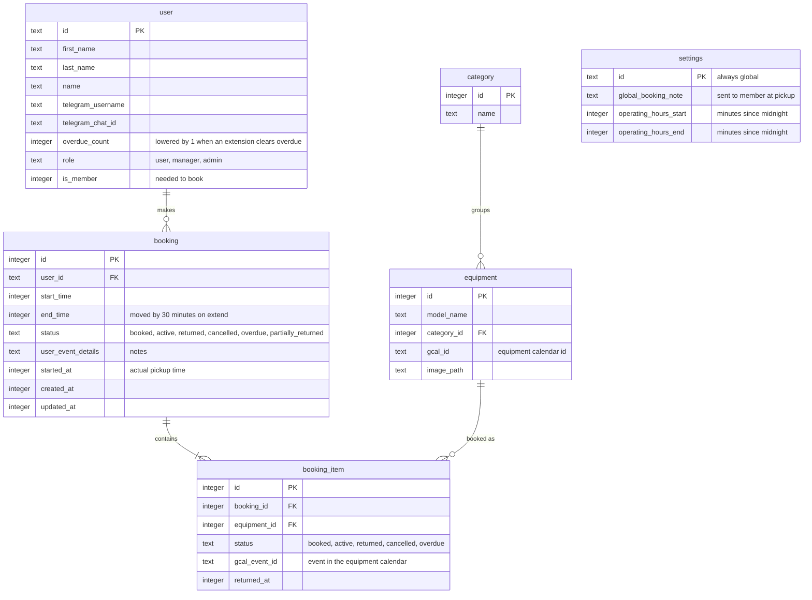

# Booking tables

> **Question:** Which tables do the booking scenarios read and
> write?
>
> **Answer:** A booking belongs to one member and holds one booking
> item per piece of equipment. Each item points to an equipment row,
> which points to a category and has its own Google calendar. A
> single settings row holds the operating hours and the Global
> Booking Note. The booking status is derived from the item
> statuses.
>
> **Notes:**
> - No KV or R2 data is used by these scenarios. Equipment images
>   are shown from R2 by the equipment folder.
> - The rate limits (10 per 60 seconds for creating a booking and
>   for adding items) use Cloudflare rate limit bindings, not KV
>   or D1.
> - The settings row has id global and is created with hours 0 to
>   1439 if it is missing when the hours are first read.
> - Dates are stored as millisecond timestamps.
> - Item status has no partially_returned value. That booking
>   status is derived.

