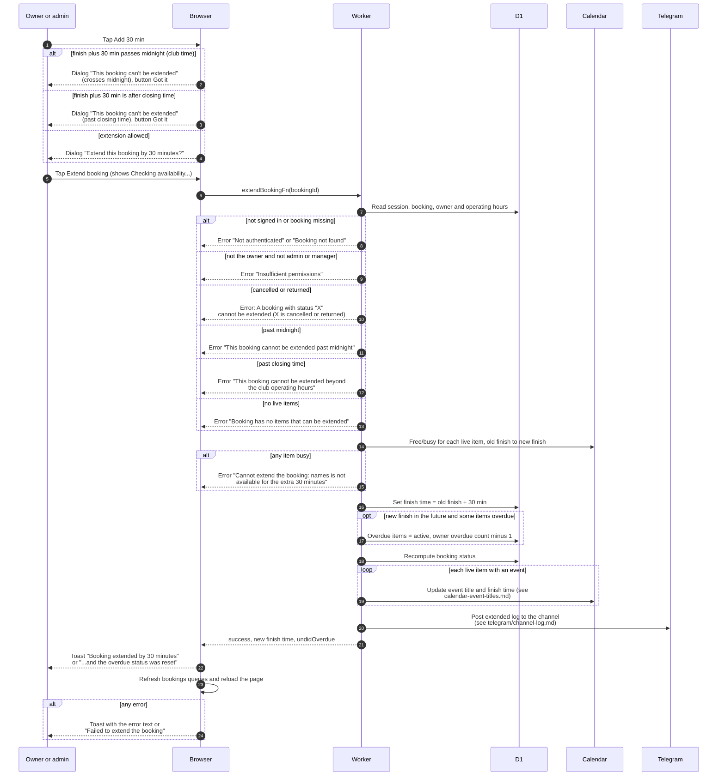

# Extend a booking by 30 minutes

> **Question:** What happens when someone taps "Add 30 min"?
>
> **Answer:** The booking's finish time moves 30 minutes later if
> that stays inside the same club day and the operating hours, and
> every live item is free for the extra 30 minutes. The owner, or an
> admin or manager, taps "Add 30 min" and confirms. On success each
> item's calendar event gets the new finish time, the Telegram
> channel gets a post, and the toast says "Booking extended by 30
> minutes". On an overdue booking, if the new finish time is in the
> future, overdue items return to active and the member's overdue
> count goes down by one.
>
> **Notes:**
> - The button shows for booked, active, partially returned and
>   overdue bookings. It can be tapped repeatedly. It appears on
>   the booking page, the edit page and the expanded rows of the
>   lists, for members and admins.
> - The browser checks the limit first and shows a dialog "This
>   booking can't be extended" instead of the confirm dialog. The
>   server repeats the check. Both use club time and the closing
>   minute from the settings.
> - The availability check runs only when the person confirms, and
>   only for the extra 30 minutes after the current finish time.
> - If the new finish time is still in the past, the booking stays
>   overdue and the overdue count is not changed.
> - The overdue count never goes below 0.
> - The overdue marking itself is done by the clock, see
>   ../cron/bookings/mark-overdue.md.

