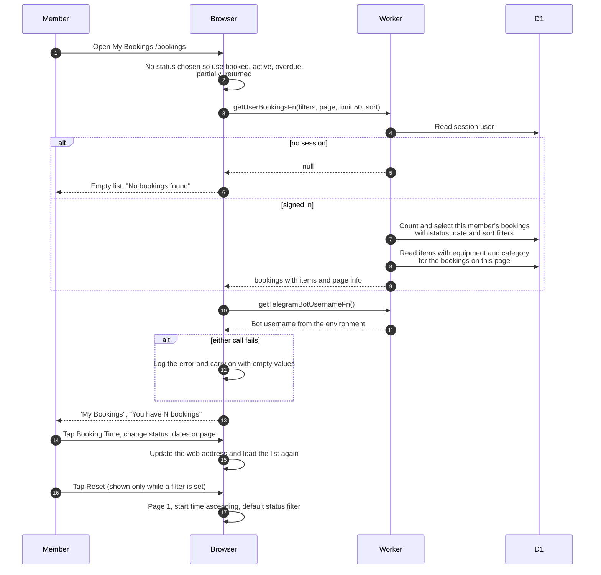

# My Bookings list

> **Question:** What does a member see on the My Bookings page and
> how do filters and paging work?
>
> **Answer:** The page lists only the signed-in member's own
> bookings with their items, 50 per page by default. Until the
> member chooses a status filter it shows booked, active, overdue
> and partially returned bookings and hides returned and cancelled
> ones. Sorting, status, date range and page are kept in the web
> address, so each change loads the list again. If the list call
> fails the page opens with an empty list.
>
> **Notes:**
> - The page has one sort button, Booking Time, which flips the
>   start time between oldest first (default) and newest first. The
>   address can also carry end time, status, created time or
>   equipment name (alphabetically first item). Page size at most
>   100 per request.
> - Only club members reach this page. Anyone else is sent to
>   their profile page.
> - Each row can be ticked, and "Cancel Selected" cancels the
>   ticked bookings, see cancel-booking.md.
> - Date filter: start date keeps bookings starting on or after it.
>   End date keeps bookings finishing by the end of that day. The
>   day boundaries come from the browser's own time zone.
> - The server can also filter by one equipment id, but this page
>   has no control for it.
> - A visitor without a session gets null from the list call and
>   the page shows the empty list.
> - Opening a row's actions leads to booking-details.md,
>   edit-booking.md, cancel-booking.md or cancel-item.md.
> - The Telegram bot username is used for the Return link on active
>   bookings, see return-booking.md.

