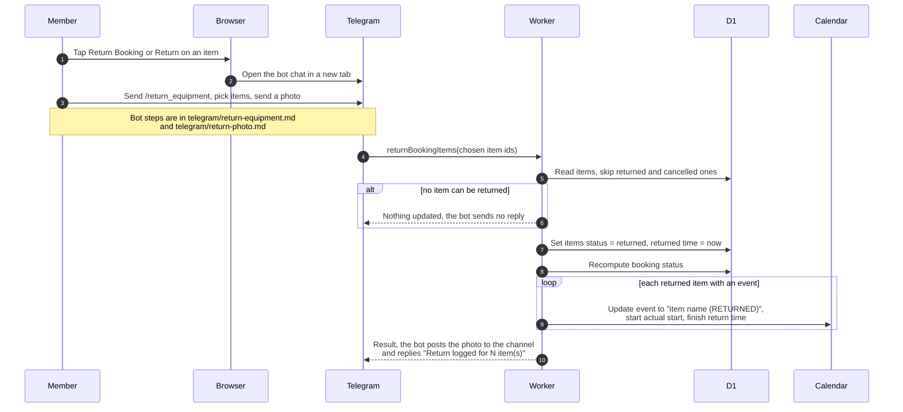

# Return equipment

> **Question:** How is equipment returned, given the website has no
> return button?
>
> **Answer:** The website only links to the Telegram bot. On a
> booking that is active, partially returned or overdue, "Return
> Booking" (or "Return" on one item) opens the bot chat, and the
> member sends /return_equipment there, picks the items and sends
> a photo. When the photo arrives, the shared return logic marks
> the chosen items returned with the time, recalculates the booking
> status and rewrites each item's calendar event to show the real
> period. When every live item is returned the booking becomes
> returned.
>
> **Notes:**
> - The bot steps are in ../telegram/return-equipment.md and
>   ../telegram/return-photo.md. This file covers only what the
>   booking data does. The link opens the bot chat only. It does
>   not pick the booking or items.
> - Status after a return: all items returned gives returned. Some
>   returned and others still live gives partially returned. An
>   overdue item keeps the booking overdue.
> - The event starts at the actual start time, or at the booked
>   start if the booking was never started. It finishes at the
>   actual return time, even if that is later than booked.
> - A failed calendar update is only logged.
> - Items already returned or cancelled are skipped.
> - Late handling by the clock is in
>   ../cron/bookings/mark-overdue.md.

