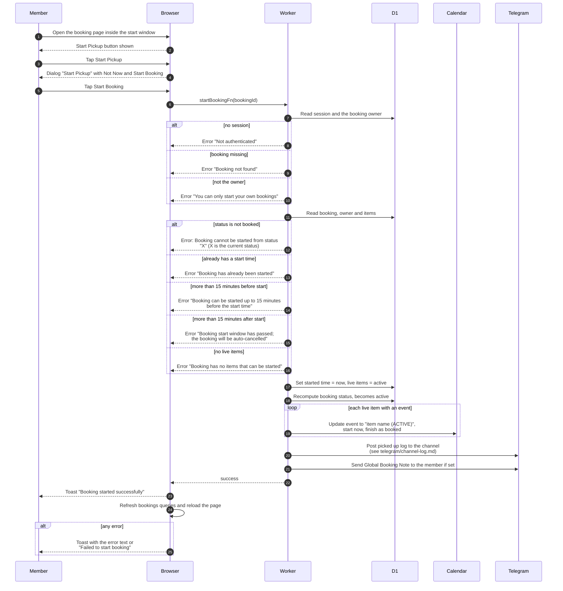

# Start a booking (pickup)

> **Question:** What happens when a member starts a booking from
> the website?
>
> **Answer:** From 15 minutes before the booked start to 15 minutes
> after it, the booking page shows "Start Pickup". The member
> confirms with "Start Booking". The server records the actual start
> time, sets every live item to active, sets the booking to active,
> moves each calendar event to start now and keep its booked
> finish, and posts to the Telegram channel. If the club has a
> Global Booking Note and the member linked Telegram, the note is
> also sent to them as a message. The member sees "Booking started
> successfully".
>
> **Notes:**
> - Only the booking's owner can start it here. Admins cannot.
> - Before the window opens the server says "Booking can be started
>   up to 15 minutes before the start time". After it closes it says
>   "Booking start window has passed" and the booking is cancelled
>   by the clock, see ../cron/bookings/cancel-unstarted.md.
> - The same start logic is used by the Telegram Start Booking
>   command, see ../telegram/start-booking.md.
> - The Global Booking Note is the only reason that message is sent.
>   A failure sending it, or the channel post, is only logged.
> - Returning equipment is not possible on the website. See
>   return-booking.md.

