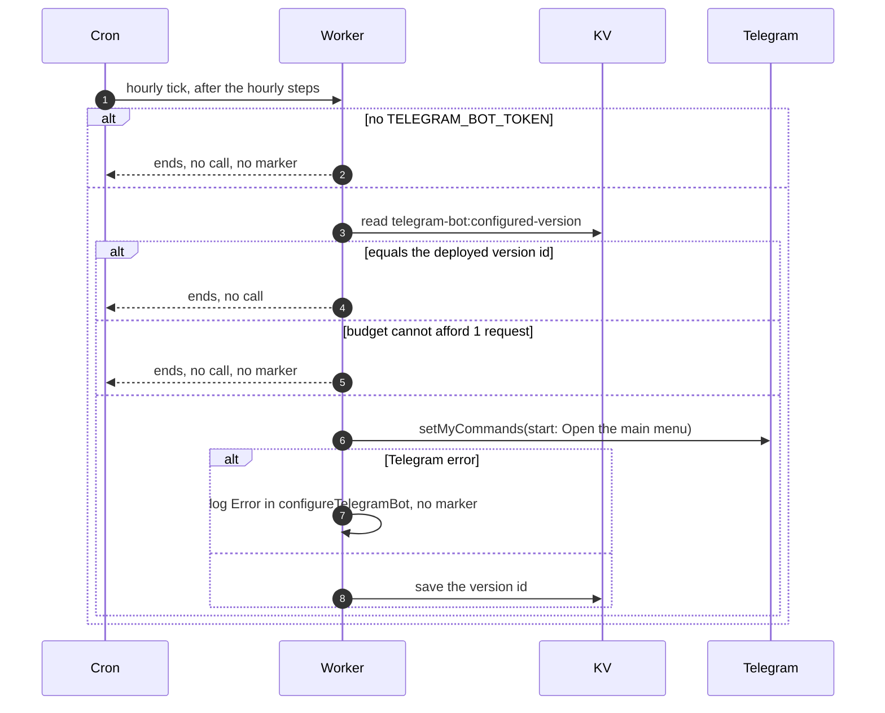

# Keeping the Telegram bot command list in sync

> **Question:** How often does the cron contact Telegram to set up
> the bot, and what does it set?
>
> **Answer:** Once per deploy. Each hourly tick compares the
> deployed Worker version id with a marker in KV. If they differ and
> there is a bot token and one request to spare, the worker tells
> Telegram the bot's command list: a single command, "start",
> described as "Open the main menu". Then it saves the version id,
> so later ticks of the same deploy only read the marker and make no
> Telegram call. Nothing is shown to any person.
>
> **Notes:**
> - The marker is KV key `telegram-bot:configured-version`. The
>   version id comes from the `CF_VERSION_METADATA` binding in
>   `wrangler.jsonc`, which changes on every deploy. The owner needs
>   no extra deploy step. A successful run logs
>   "[cron] configured Telegram bot for version ID".
> - Costs 1 request of the hourly tick's 40. Reading the marker is a
>   KV read and is not counted.
> - Without TELEGRAM_BOT_TOKEN the step returns without a call and
>   without saving the marker, so it configures the bot on the first
>   tick after the token is set. If the tick is out of budget it is
>   skipped until the next hour.
> - If Telegram refuses, the marker is not saved, the error goes to
>   the log line "Error in configureTelegramBot" and the next hourly
>   tick tries again.
> - The round menu button next to the message box is managed in
>   BotFather and is not touched here, since the API can only swap
>   it, never remove it.

